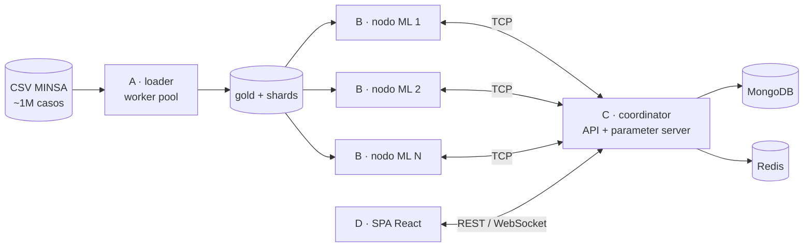

<div align="center">

# cc65-tf-dengue

**Regresión logística distribuida en Go sobre ~1 millón de casos de dengue del Perú**<br>
Clúster de nodos por TCP · API con latencia < 100 ms · MongoDB + Redis · SPA en tiempo real · Docker Compose

Trabajo Final · Programación Concurrente y Distribuida (CC65) · UPC 2026-20 · ODS 3

</div>

## La pregunta

> ¿En qué departamentos, semanas epidemiológicas y grupos de edad conviene reforzar camas,
> vigilancia y cerco epidemiológico por **dengue con signos de alarma o grave**?

Perú vivió en 2023 y 2024 epidemias de dengue de magnitud histórica. Anticipar dónde
y cuándo aparecerán los casos que requieren hospitalización permite redistribuir recursos
antes de que los establecimientos colapsen.

## Datos

[Vigilancia epidemiológica de dengue (MINSA / CDC Perú)](https://www.datosabiertos.gob.pe/dataset/vigilancia-epidemiol%C3%B3gica-de-dengue),
serie 2000-2025, un registro por caso notificado (~1 000 000 filas, 118 MB). Los datos no se
versionan: `make data` los descarga y verifica su checksum.

## Arquitectura



| Parte | Patrón de concurrencia | Carpeta |
|---|---|---|
| A · Cargador | Worker pool sobre bloques de bytes del CSV | `cmd/loader`, `internal/ingest` |
| B · Entrenamiento | Data parallelism: cada nodo, un shard; dentro, worker pool + reducción ordenada | `cmd/node`, `internal/ml` |
| C · API / coordinador | Parameter server síncrono (barrera por época) + servidor HTTP concurrente | `cmd/coordinator`, `internal/api`, `internal/cluster` |
| D · Visualización | SPA con métricas en vivo por WebSocket | `web/` |

## Cómo ejecutarlo

Requisitos: **Docker** con Compose v2 (Docker Desktop en Windows o macOS). Para desarrollar y
correr las pruebas: Go 1.24+ y Node 22. En Linux, antepón `USUARIO="$(id -u):$(id -g)"` a los
comandos de Compose para que los contenedores escriban en `data/` y `reports/` con tu usuario.
En PowerShell, las variables se fijan antes: `$env:API=":8080"; $env:DEMO="true"; docker compose …`.

### 1. Datos (una vez)

```bash
make data     # descarga el CSV del MINSA a data/bronze/ y verifica su sha256
```

El portal responde `HTTP 418` a centros de datos y a clientes sin navegador. Si pasa, descarga el
archivo con un navegador desde una red doméstica o de la universidad, guárdalo como
`data/bronze/vigilancia_dengue_2000_2025.csv` y vuelve a correr `make data`, que solo verifica el
sha256 contra `data/MANIFEST.sha256`.

### 2. Parte A en Docker: del CSV al gold y al modelo inicial

```bash
docker compose -f deploy/docker-compose.yml --profile datos up entrenar
```

Corre en orden, cada uno en su contenedor y sin red: `loader` (bronze → `data/silver/`,
`reports/limpieza.json`) → `gold` (features, split y un shard por nodo en `data/gold/`,
`reports/split.json`) → `entrenar` (modelo inicial `data/gold/modelo.json`,
`reports/entrenamiento.json`). `NODOS=5` genera 5 shards. Con Go en el anfitrión es lo mismo:
`go run ./cmd/loader && go run ./cmd/gold && go run ./cmd/entrenar`.

**Sin el CSV** (solo para probar la infraestructura): un gold sintético con la misma forma (31
variables). No significa nada epidemiológicamente; el mapa y la evaluación siguen mostrando
`reports/evaluacion.json` del dato real.

```bash
docker compose -f deploy/docker-compose.yml --profile datos run --rm --no-deps gold /usr/local/bin/gold -sintetico 300000 -shards 3
docker compose -f deploy/docker-compose.yml --profile datos run --rm --no-deps entrenar /usr/local/bin/entrenar -salida reports/entrenamiento_sintetico.json
```

### 3. Sistema completo: SPA + API + clúster + MongoDB + Redis

```bash
cp deploy/.env.example deploy/.env      # completa JWT_SECRETO y las claves de admin y analista
API=:8080 DEMO=true docker compose -f deploy/docker-compose.yml -f deploy/docker-compose.api.yml up --build
```

| Qué | Dónde |
|---|---|
| SPA Vigía (login con las cuentas de `deploy/.env`) | <http://localhost:8081> |
| API REST + WebSocket | <http://localhost:8080> |
| Swagger (contrato OpenAPI) | <http://localhost:8080/docs> |

Levanta 7 contenedores: `coordinator` (API + parameter server), 3 `node`, `mongo`, `redis` y `web`.
Solo se publican la API y la SPA; los nodos, MongoDB y Redis quedan en la red interna `cluster`.
Opciones: `NODOS` (nodos del clúster), `DEMO=true` (botón «Tumbar» y pausa entre épocas),
`EVENTOS=/reports/eventos_demo.jsonl` (graba los eventos para la réplica del panel admin),
`PUERTO_API` y `PUERTO_WEB`. Para entrar por IP (p. ej. en la sustentación), fija
`API_URL=http://<ip>:8080` y `CORS_ORIGENES=http://<ip>:8081`: CORS, la CSP y el WebSocket
exigen el origen exacto.

### 4. Solo el entrenamiento distribuido, y verificarlo

```bash
VERIFICAR=true docker compose -f deploy/docker-compose.yml up --build --exit-code-from coordinator
go run ./cmd/entrenar -comparar reports/entrenamiento_cluster.json   # pesos idénticos bit a bit
bash scripts/prueba-caida.sh                                          # mata un nodo a mitad y exige lo mismo
```

### 5. Pruebas

```bash
make check    # gofmt + go vet + go test -race ./...
make web      # tipos, Vitest y build de la SPA
```

Más detalle del despliegue (imágenes, variables, red, evidencias): [`deploy/README.md`](deploy/README.md).

## Entregables

| Entregable | Fecha | Contenido | Tag |
|---|---|---|---|
| PC3 | 07/11/2026 | Caso, limpieza, diseño ML distribuido, paralelización en Go | `pc3` |
| PC4 | 21/11/2026 | Clúster TCP, API (Swagger, < 100 ms), MongoDB + Redis | `pc4` |
| TB2 | 29/11/2026 | SPA, integración segura, evaluación experimental, informe final | `tb2` |

## Cómo trabajamos

- **Git Flow:** todo entra por Pull Request a `develop`; `main` solo recibe releases.
- **Kanban:** cada tarea es un issue en el tablero del proyecto.
- **Multiagente:** Claude Code implementa, Antigravity juzga cada PR contra la rúbrica y el
  equipo aprueba el merge. Protocolo en [`docs/agentes/PROTOCOLO.md`](docs/agentes/PROTOCOLO.md);
  los veredictos quedan en `docs/agentes/revisiones/`.
- **Reglas para agentes:** [`AGENTS.md`](AGENTS.md).
- **Decisiones de diseño:** [`docs/decisiones/`](docs/decisiones/).

## Equipo

| Integrante | GitHub |
|---|---|
| José Javier Villanueva Aramburú (coordinador) | [@JJva-06](https://github.com/JJva-06) |
| Jorge Rolando García Roca | [@JorgeGarcia005](https://github.com/JorgeGarcia005) |
