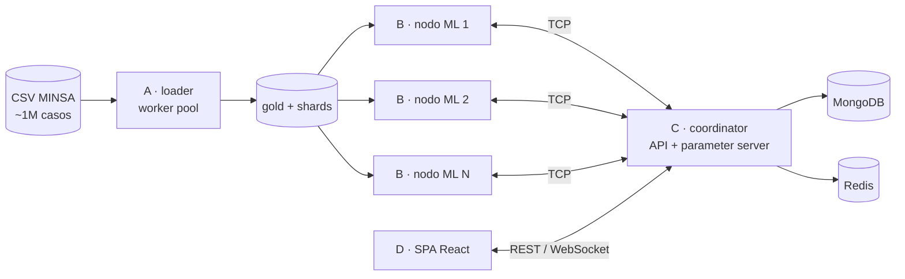

<div align="center">

# cc65-tf-dengue

**Regresión logística distribuida en Go sobre ~1 millón de casos de dengue del Perú**<br>
Clúster de nodos por TCP · API con latencia < 100 ms · MongoDB + Redis · SPA en tiempo real · Docker Compose

Trabajo Final · Programación Concurrente y Distribuida (CC65) · UPC 2026-20 · ODS 3

</div>

## La pregunta

> ¿En qué distritos, semanas epidemiológicas y grupos de edad conviene reforzar camas,
> vigilancia y cerco epidemiológico por **dengue con signos de alarma o grave**?

Perú vivió en 2023 y 2024 epidemias de dengue de magnitud histórica. Anticipar dónde
y cuándo aparecerán los casos que requieren hospitalización permite redistribuir recursos
antes de que los establecimientos colapsen.

## Datos

[Vigilancia epidemiológica de dengue (MINSA / CDC Perú)](https://www.datosabiertos.gob.pe/dataset/vigilancia-epidemiol%C3%B3gica-de-dengue),
serie 2000-2025, un registro por caso notificado (~1 000 000 filas, 118 MB). Los datos no se
versionan: `make data` los descarga y verifica su checksum.

## Arquitectura



| Parte | Patrón de concurrencia | Carpeta |
|---|---|---|
| A · Cargador | Worker pool sobre bloques de bytes del CSV | `cmd/loader`, `internal/ingest` |
| B · Entrenamiento | Data parallelism: cada nodo, un shard; dentro, worker pool + reducción ordenada | `cmd/node`, `internal/ml` |
| C · API / coordinador | Parameter server síncrono (barrera por época) + servidor HTTP concurrente | `cmd/coordinator`, `internal/api`, `internal/cluster` |
| D · Visualización | SPA con métricas en vivo por WebSocket | `web/` |

## Entregables

| Entregable | Fecha | Contenido | Tag |
|---|---|---|---|
| PC3 | 07/11/2026 | Caso, limpieza, diseño ML distribuido, paralelización en Go | `pc3` |
| PC4 | 21/11/2026 | Clúster TCP, API (Swagger, < 100 ms), MongoDB + Redis | `pc4` |
| TB2 | 29/11/2026 | SPA, integración segura, evaluación experimental, informe final | `tb2` |

## Cómo trabajamos

- **Git Flow:** todo entra por Pull Request a `develop`; `main` solo recibe releases.
- **Kanban:** cada tarea es un issue en el tablero del proyecto.
- **Multiagente:** Claude Code implementa, Antigravity juzga cada PR contra la rúbrica y el
  equipo aprueba el merge. Protocolo en [`docs/agentes/PROTOCOLO.md`](docs/agentes/PROTOCOLO.md);
  los veredictos quedan en `docs/agentes/revisiones/`.
- **Reglas para agentes:** [`AGENTS.md`](AGENTS.md).
- **Decisiones de diseño:** [`docs/decisiones/`](docs/decisiones/).

```bash
make check    # gofmt + vet + go test -race
make data     # descarga y verifica el dataset
```

## Equipo

| Integrante | GitHub |
|---|---|
| José Javier Villanueva Aramburú (coordinador) | [@JJva-06](https://github.com/JJva-06) |
| Jorge Rolando García Roca | [@JorgeGarcia005](https://github.com/JorgeGarcia005) |
| Marco Antonio Luciano Cabrera Díaz | — |
