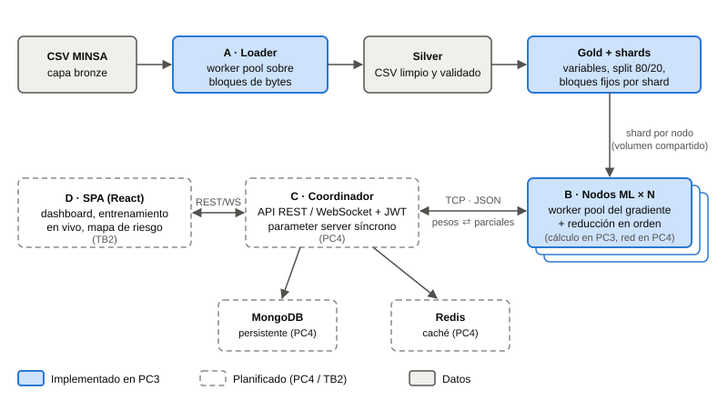

# 4. Arquitectura de la solución

La solución sigue la arquitectura de referencia del enunciado: cuatro partes que funcionan como una
cadena y que se pueden desarrollar por separado. Los datos pasan por tres capas (*medallion*): **bronze**
(el CSV original, sin tocar), **silver** (filas limpias y validadas) y **gold** (la matriz numérica de
entrenamiento, partida en shards para los nodos).

| Parte | Componente | Patrón de concurrencia | Estado |
|---|---|---|---|
| A | Cargador concurrente (`cmd/loader`, `internal/ingest`) | *Worker pool* sobre bloques de bytes alineados a fin de línea, slots por bloque y concatenación en orden | Implementado (PC3) |
| B | Motor de entrenamiento (`cmd/entrenar`, `internal/ml`, `internal/features`, `internal/gold`) | *Worker pool* persistente, *fan-out* por canal, acumuladores privados, barrera y *fan-in* ordenado | Cálculo implementado (PC3); nodos por TCP en PC4 |
| C | Coordinador: API REST/WebSocket y *parameter server* | Servidor HTTP concurrente, una goroutine lectora por nodo, barrera por época | Diseñado y verificado con Spin (PC3); se implementa en PC4 |
| D | SPA de visualización | Métricas del entrenamiento en vivo por WebSocket | TB2 |

## 4.1 Restricciones de diseño

Estas reglas son comunes a todo el código y las revisa el agente juez en cada Pull Request:

1. **Go para todo el backend y núcleo con biblioteca estándar:** la concurrencia se expresa con goroutines
   y canales (Donovan & Kernighan, 2015). El loader, el modelo de ML, el protocolo
   TCP y la API usan solo la biblioteca estándar de Go. Los únicos terceros permitidos son los drivers de
   MongoDB y Redis, aprobados por el profesor. No se usa ninguna biblioteca de ML.
2. **Determinismo:** los bloques de datos tienen límites fijos, independientes del número de workers o
   nodos, y las sumas parciales se reducen en orden de índice de bloque. El resultado distribuido debe ser
   idéntico bit a bit al secuencial, y hay tests que lo exigen.
3. **Sin condiciones de carrera:** todo test se ejecuta con `go test -race`; no hay estado compartido
   mutable sin canal o mutex, y se prefieren acumuladores privados.
4. **Ninguna cifra a mano:** toda tabla, gráfico y cifra de este informe se genera con `cmd/informe` desde
   los reportes JSON que producen los propios programas.
5. **Datos no versionados:** el CSV no se sube al repositorio; se versiona el script que lo descarga y su
   checksum SHA-256, que fija el archivo exacto usado en los resultados.
