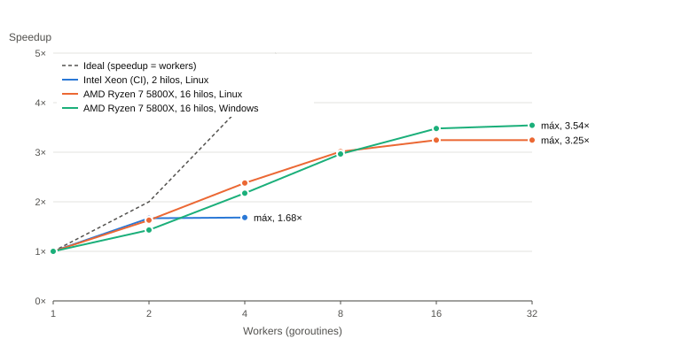

<!-- Generado por cmd/informe desde reports/limpieza.json y reports/bench_loader_*.json. No editar a mano. -->

# 6. Limpieza y carga concurrente (Parte A)

## 6.1 Procedimiento

El loader (`cmd/loader`) lee el CSV original completo en memoria, lo divide en
**113 bloques** de ~1 MiB que siempre terminan en un salto de línea y los reparte a un
*worker pool*. Cada worker parsea, valida y normaliza las filas de su bloque y escribe el
resultado en un slot propio; al final los bloques se concatenan **en orden**. Por eso el CSV
limpio (capa silver) es **idéntico byte a byte** para cualquier número de workers
(verificado con sha256: `192f2824eb06a158f02776011f524598d850b3e6b505114dbe159778926888f7`).

Cada fila se evalúa contra las reglas en este orden y se descarta por la **primera** que
incumple, así que cada fila descartada se cuenta una sola vez:

| # | Regla | Filas descartadas |
|---:|---|---:|
| 1 | mal_formada (columnas ≠ 15 aun reparando comillas) | 0 |
| 2 | diagnostico fuera de A97.0/A97.1/A97.2 | 0 |
| 3 | enfermedad no coincide con el código CIE-10 | 0 |
| 4 | año fuera de 2000–2025 | 0 |
| 5 | semana epidemiológica fuera de 1–53 | 0 |
| 6 | edad no numérica, negativa o tipo_edad ∉ {A,M,D} | 0 |
| 7 | edad mayor a 110 años | 14 |
| 8 | sexo ∉ {F,M} | 0 |
| 9 | tipo_dx ∉ {C,P} | 0 |
| 10 | ubigeo no numérico o de largo ≠ 5/6 | 0 |
| 11 | departamento vacío | 0 |

Además de descartar, el loader **repara** sin perder filas:

- **Comillas sin escapar:** 85 filas traen comillas dentro del campo
  `localidad` (p. ej. `"ISLA SANTA ROSA "AMAZONAS""`), que el estándar CSV no admite. Se
  recuperan con un segundo intento de parseo que trata esas comillas como texto.
- **Ubigeo de 5 dígitos:** 0 filas (se rellena el cero inicial).
- **Edad:** se normaliza a años según `tipo_edad` (A = años, M = meses / 12, D = días / 365).

**Filas idénticas:** 148 787 filas repiten exactamente a otra. **No se eliminan**: el
dataset no tiene identificador de paciente, y dos casos reales pueden coincidir en todos los
campos (misma localidad, semana, edad y sexo). Eliminarlas borraría casos verdaderos.

## 6.2 Resultado

| | Filas |
|---|---:|
| Entrada (bronze) | 1 065 274 |
| Descartadas | 14 |
| **Salida (silver)** | **1 065 260** |
| Positivos (con signos o grave) | 120 601 (11,32 %) |

## 6.3 Rendimiento de la carga concurrente

**Intel(R) Xeon(R) Processor @ 2.10GHz** · 2 CPU lógicas · linux (`bench_loader_ci-2vcpu.json`)

| Workers | Media recortada (ms) | IC 95 % (ms) | Speedup | Eficiencia | Filas/s | Silver = secuencial |
|---:|---:|---|---:|---:|---:|:---:|
| 1 | 751,7 | [729,5, 772,8] | 1,00× | 100,00 % | 1 417 238 | ✔ |
| 2 | 450,8 | [440,7, 461,6] | 1,67× | 83,37 % | 2 363 204 | ✔ |
| 4 | 447,0 | [437,6, 457,8] | 1,68× | 42,04 % | 2 383 232 | ✔ |

**AMD Ryzen 7 5800X 8-Core Processor** · 16 CPU lógicas · linux (`bench_loader_deez-wsl-debian.json`)

| Workers | Media recortada (ms) | IC 95 % (ms) | Speedup | Eficiencia | Filas/s | Silver = secuencial |
|---:|---:|---|---:|---:|---:|:---:|
| 1 | 546,5 | [541,6, 551,8] | 1,00× | 100,00 % | 1 949 330 | ✔ |
| 2 | 335,6 | [332,2, 340,8] | 1,63× | 81,41 % | 3 173 906 | ✔ |
| 4 | 229,8 | [227,4, 232,2] | 2,38× | 59,46 % | 4 636 178 | ✔ |
| 8 | 181,4 | [179,7, 182,9] | 3,01× | 37,67 % | 5 874 015 | ✔ |
| 16 | 168,4 | [167,2, 169,8] | 3,25× | 20,28 % | 6 326 025 | ✔ |
| 32 | 168,5 | [166,8, 170,4] | 3,24× | 10,14 % | 6 323 930 | ✔ |

**AMD Ryzen 7 5800X 8-Core Processor** · 16 CPU lógicas · windows (`bench_loader_deez.json`)

| Workers | Media recortada (ms) | IC 95 % (ms) | Speedup | Eficiencia | Filas/s | Silver = secuencial |
|---:|---:|---|---:|---:|---:|:---:|
| 1 | 558,3 | [545,6, 574,3] | 1,00× | 100,00 % | 1 907 933 | ✔ |
| 2 | 390,1 | [381,4, 406,9] | 1,43× | 71,56 % | 2 730 632 | ✔ |
| 4 | 256,9 | [250,4, 265,5] | 2,17× | 54,33 % | 4 146 622 | ✔ |
| 8 | 188,3 | [182,7, 195,0] | 2,96× | 37,06 % | 5 656 414 | ✔ |
| 16 | 160,5 | [152,9, 171,6] | 3,48× | 21,74 % | 6 636 323 | ✔ |
| 32 | 157,6 | [149,7, 168,4] | 3,54× | 11,07 % | 6 759 067 | ✔ |

Protocolo: limpieza completa en memoria (sin lectura de disco), un calentamiento, repeticiones
en orden barajado, `runtime.GC()` antes de cada medición, media recortada al 10 % e intervalo
de confianza por bootstrap.
