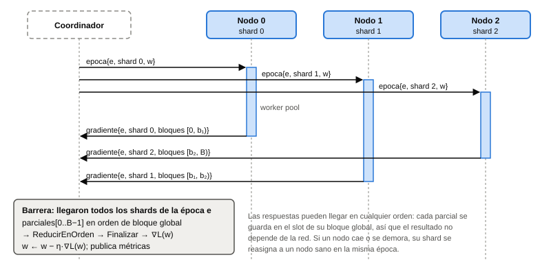

# 8. Diseño del clúster distribuido y verificación formal

La sección 7.4 mostró que el gradiente se puede repartir por shards sin cambiar el resultado. Esta sección
define **cómo** se comunican el coordinador y los nodos, decisión que se implementa en PC4. Por ser cara
de revertir, pasó por un debate de diseño entre agentes antes de escribir código
(`docs/decisiones/propuestas/protocolo-tcp.md`).

## 8.1 Topología: estrella con *parameter server* síncrono

| Alternativa | Decisión | Motivo |
|---|---|---|
| **Estrella con *parameter server* síncrono** | **Elegida** | Cada época es una barrera: el coordinador difunde los pesos, espera los parciales de todos los shards y actualiza. Reproduce exactamente el descenso de gradiente secuencial |
| *Parameter server* asíncrono | Descartada | Los nodos calcularían con pesos viejos y el orden de las actualizaciones dependería de la red: ni reproducible ni equivalente al secuencial |
| *Ring all-reduce* entre nodos | Descartada | Los nodos tendrían que conocerse entre sí y el orden de la suma dependería del anillo; con pocos nodos y mensajes de pocos KB por época la red no es el cuello de botella |
| Reducción local en cada nodo | Descartada | Menos tráfico, pero rompe la equivalencia bit a bit (sección 8.2) |

## 8.2 La restricción que manda: el orden de la suma

`ml.ReducirEnOrden` suma los parciales de izquierda a derecha, $((g_0 + g_1) + g_2) + \dots$. La suma en
punto flotante **no es asociativa** (Goldberg, 1991): si cada nodo sumara primero sus bloques y el
coordinador sumara los totales de los nodos, el resultado cambiaría con el número de nodos. Por eso cada
nodo devuelve **un parcial por bloque**, sin reducirlos, y el coordinador los coloca en el slot de su
índice global de bloque y reduce todo en orden. El orden de llegada de los nodos deja de importar.

## 8.3 Protocolo

TCP con una conexión persistente por nodo (el nodo se conecta al coordinador) y mensajes **JSON
delimitados por salto de línea**, leídos con `json.Decoder`. `encoding/json` escribe cada `float64` con la
representación más corta que vuelve exactamente al mismo valor, así que los bits se conservan en la red.

| Mensaje | Sentido | Contenido |
|---|---|---|
| `registro` | nodo → coordinador | identificador del nodo, versión del protocolo, workers |
| `asignacion` | coordinador → nodo | shard, ruta y checksum del archivo, bloque inicial, número de bloques, configuración |
| `listo` | nodo → coordinador | lo que el nodo leyó del archivo, para comprobar que es el shard correcto |
| `epoca` | coordinador → nodo | número de época, shard y pesos $w$ |
| `gradiente` | nodo → coordinador | época, shard y un parcial `{grad, pérdida, peso}` por bloque |
| `error` | ambos | shard inválido, gradiente no finito o versión incompatible |
| `fin` | coordinador → nodo | fin del entrenamiento (completo o abortado) |

**Concurrencia en el coordinador:** una goroutine lectora por conexión envía los mensajes a un único canal;
solo el bucle de épocas escribe a los nodos, así que nunca hay dos escritores sobre la misma conexión. El
estado de la época es local a esa goroutine y no necesita mutex. Toda escritura lleva plazo
(`SetWriteDeadline`): **enviar nunca puede bloquear el bucle de épocas**.

**Fallos:** si un nodo cae (error de lectura o escritura) o no responde dentro del plazo de la época, el
coordinador lo descarta y **reasigna su shard** a un nodo sano en la misma época. Esto no rompe el
determinismo, porque los shards son archivos fijos en un volumen compartido y la reducción depende solo
del índice de bloque. Las respuestas tardías o duplicadas se descartan por su etiqueta de época y shard.
Si no queda ningún nodo sano, el entrenamiento aborta con un error: nunca espera para siempre.

## 8.4 Verificación formal con Spin

Antes de implementar el protocolo se modeló en Promela (`spin/barrera.pml`) un coordinador y tres nodos
durante tres épocas, con canales con búfer, la caída de un nodo y un *timeout* falso (un nodo vivo pero
lento). Se verificaron con Spin 6.5.2 (Holzmann, 2003) cuatro propiedades:

| Propiedad | Cómo se expresa | Resultado |
|---|---|---|
| Ausencia de *deadlock* | Ningún estado final inválido (búsqueda exhaustiva sin la fórmula LTL) | Sin errores |
| Barrera por época | `assert`: una época avanza solo con todos los shards recibidos | Sin errores |
| Terminación | `ltl termina { <> terminado }` | Sin errores |
| Sin pérdida de shards | `assert`: si no se abortó, se completaron todas las épocas | Sin errores |

El modelo encontró **dos errores de diseño** antes de escribir el código, y ambos se corrigieron:

1. **Envío bloqueante.** Spin halló una ejecución en que el coordinador quedaba bloqueado enviando pesos a un
   nodo caído cuyo canal estaba lleno, sin llegar nunca al *timeout* que lo habría hecho abortar. De ahí
   la regla de que toda escritura lleve plazo y que un error de escritura cuente como caída.
2. **Reasignación en una sola pasada.** Un shard podía reasignarse a un nodo caído que todavía no se había
   detectado; luego ese shard no se volvía a reasignar y el coordinador repetía *timeouts* sin avanzar. La
   corrección es reasignar en dos pasadas: primero se descarta a todos los sospechosos y después se
   reasigna.

Para comprobar que el modelo distingue el diseño correcto de los errores, se verificaron dos **mutantes**
que reintroducen cada error: los dos fallan con un ciclo de aceptación, y el modelo corregido no.
