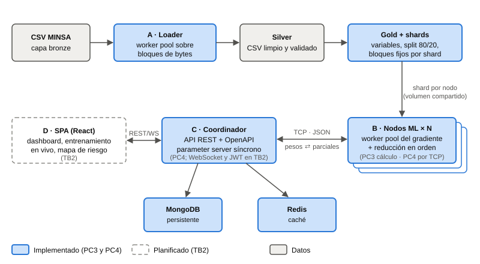

# 4. Arquitectura de la solución

La solución se organiza en cuatro partes que funcionan como una cadena y que se pueden desarrollar por
separado. Los datos pasan por tres capas (*medallion*): **bronze**
(el CSV original, sin tocar), **silver** (filas limpias y validadas) y **gold** (la matriz numérica de
entrenamiento, partida en shards para los nodos).

| Parte | Componente | Patrón de concurrencia | Estado |
|---|---|---|---|
| A | Cargador concurrente (`cmd/loader`, `internal/ingest`) | *Worker pool* sobre bloques de bytes alineados a fin de línea, slots por bloque y concatenación en orden | Implementado (PC3) |
| B | Nodos de ML (`cmd/node`, `internal/cluster`, `internal/ml`, `internal/gold`) | *Worker pool* persistente por nodo, acumuladores privados, un parcial por bloque | Cálculo en PC3; nodos por TCP en Docker en PC4 |
| C | Coordinador: *parameter server* y API REST (`cmd/coordinator`, `internal/cluster`, `internal/api`) | Una goroutine lectora por nodo, barrera por época con plazo por shard, servidor HTTP concurrente con el modelo en un `atomic.Pointer` | Implementado en PC4 (WebSocket y JWT en TB2) |
| — | Persistencia y caché (`internal/almacen`, MongoDB, Redis) | Registro de predicciones en segundo plano (un consumidor), caché *cache-aside* con presupuesto de tiempo | Implementado en PC4 |
| D | SPA de visualización | Métricas del entrenamiento en vivo por WebSocket | TB2 |

## 4.1 Restricciones de diseño

Estas reglas son comunes a todo el código y las revisa el agente juez en cada Pull Request:

1. **Go para todo el backend y núcleo con biblioteca estándar:** la concurrencia se expresa con goroutines
   y canales (Donovan y Kernighan, 2015). El loader, el modelo de ML, el protocolo
   TCP y la API usan solo la biblioteca estándar de Go. Los únicos terceros permitidos son los drivers de
   MongoDB y Redis. No se usa ninguna biblioteca de ML.
2. **Determinismo:** los bloques de datos tienen límites fijos, independientes del número de workers o
   nodos, y las sumas parciales se reducen en orden de índice de bloque. El resultado distribuido debe ser
   idéntico bit a bit al secuencial, y hay tests que lo exigen.
3. **Sin condiciones de carrera:** todo test se ejecuta con `go test -race`; no hay estado compartido
   mutable sin canal o mutex, y se prefieren acumuladores privados.
4. **Ninguna cifra a mano:** toda tabla, gráfico y cifra de este informe se genera con `cmd/informe` desde
   los reportes JSON que producen los propios programas.
5. **Datos no versionados:** el CSV no se sube al repositorio; se versiona el script que lo descarga y su
   checksum SHA-256, que fija el archivo exacto usado en los resultados.

## 4.2 Despliegue

El coordinador y los nodos corren en contenedores construidos desde **una sola imagen** Docker
(`deploy/Dockerfile`): compila de forma estática solo los dos binarios que se despliegan, `coordinator` y
`node`, sobre `distroless/static` y con un usuario sin privilegios. Las herramientas de carga, benchmark e
informe (`cmd/loader`, `cmd/benchmark`, `cmd/informe`…) se ejecutan en el anfitrión con `go run`. Docker
Compose (`deploy/docker-compose.yml`) levanta un coordinador, N nodos (`NODOS=N`: el coordinador espera
exactamente esos N), MongoDB y Redis en una red interna; el gold y los shards se montan en un volumen de
solo lectura. Hay dos modos:

| Modo | Comando | Para qué |
|---|---|---|
| Entrenamiento único | `NODOS=3 VERIFICAR=true docker compose -f deploy/docker-compose.yml up --build --exit-code-from coordinator` | Entrena una vez en el clúster, escribe `reports/entrenamiento_cluster.json` y, con `VERIFICAR=true`, repite el entrenamiento en secuencial dentro del contenedor y falla si los pesos difieren |
| Servicio | `API=:8080 docker compose -f deploy/docker-compose.yml -f deploy/docker-compose.api.yml up --build` | Sirve la API REST (Swagger en `/docs`) conectada a MongoDB y Redis y entrena en el clúster con cada `POST /api/v1/entrenamientos` |

## 4.3 Dónde está cada punto de los entregables

### PC3 (corregido)

| Punto del Entregable 1 (enunciado) | Dónde está en este informe |
|---|---|
| Presentación del caso: problema, motivación, pregunta de impacto social y pregunta que resuelve el problema | Secciones 2.1 a 2.5 |
| Limpieza y análisis de datos: procedimiento y evidencias | Sección 5 (perfil del dataset) y sección 6 (reglas, resultado y rendimiento de la limpieza) |
| Diseño del modelo ML distribuido: explicación del algoritmo | Secciones 7.1, 7.2 y 7.4 (ecuaciones del gradiente y de la agregación) y sección 8 (clúster y protocolo) |
| Paralelización del cálculo: justificación, técnicas y patrones en Go | Secciones 5.5, 6.1 y 7.3, y la tabla de componentes y patrones del inicio de esta sección |
| Evidencias de la implementación: código en Go y pruebas | Secciones 12.1 y 12.2, y secciones 6.3 y 7.7 (*speedup* medido) |
| Cambios subidos a GitHub y tablero Kanban | Secciones 12.6 y 12.7, y anexos |
| Reporte de participación | Archivo aparte en el Aula Virtual (formato del docente) |

### PC4

| Punto del Entregable 2 (enunciado PC4) | Dónde está en este informe |
|---|---|
| Distribución: clúster de nodos de ML, justificación de la topología y funcionamiento en Go | Sección 8 (topología, protocolo, código fuente del algoritmo distribuido, tolerancia a fallos, verificación con Spin) y sección 9 (rendimiento por número de nodos) |
| API: documentación con Swagger y respuesta en menos de 100 ms con pantallazos de Postman | Sección 10 y sección 12.3 |
| Bases de datos: diseño de entidades y registros | Sección 11 y sección 12.4 |
| Evidencias: datos de prueba y pantallazos | Sección 12 |
| Informe con el entregable anterior corregido | Secciones 2 a 7 y tabla «Correcciones a la PC3» en los anexos (sección 16) |
| GitHub y tablero Kanban | Secciones 12.6 y 12.7 y anexos |
| Reporte de participación | Archivo aparte en el Aula Virtual (formato del docente) |
