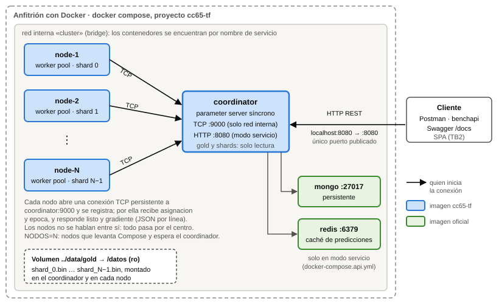
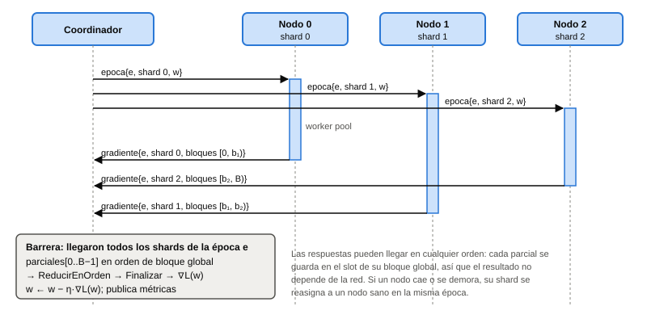
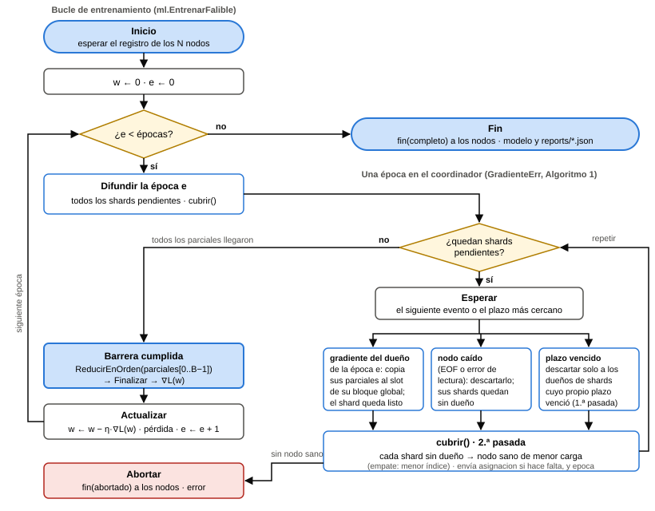
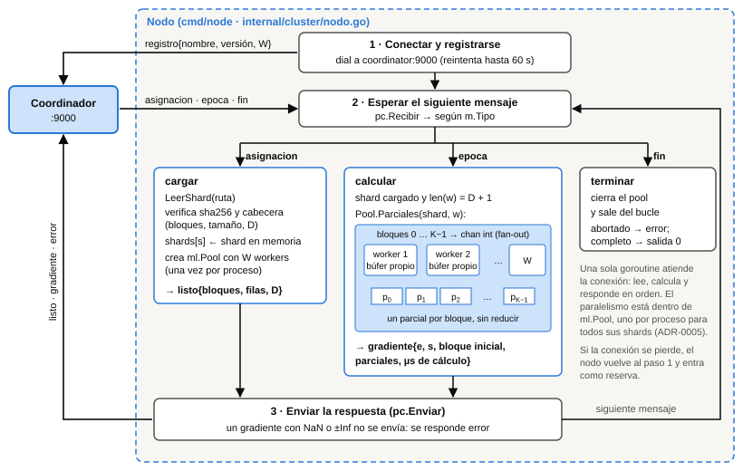

# 8. Clúster distribuido: diseño, implementación y verificación

La sección 7.4 mostró que el gradiente se puede repartir por shards sin cambiar el resultado. En la PC3 se
diseñó el clúster y se verificó su protocolo; en esta entrega se implementó en Go
(`internal/cluster`, `cmd/coordinator`, `cmd/node`) y se desplegó con Docker. Por ser una decisión cara de
revertir, el protocolo pasó por un debate de diseño entre agentes antes de escribir código: el
implementador lo propuso (`docs/decisiones/propuestas/protocolo-tcp.md`), el juez respondió con cuatro
objeciones (`protocolo-tcp-juez.md`) y la decisión quedó en `docs/decisiones/ADR-0005-protocolo-tcp.md`
(sección 8.8).

## 8.1 Topología: estrella con *parameter server* síncrono

| Alternativa | Decisión | Motivo |
|---|---|---|
| **Estrella con *parameter server* síncrono** | **Elegida** | Cada época es una barrera: el coordinador difunde los pesos, espera los parciales de todos los shards y actualiza. Reproduce exactamente el descenso de gradiente secuencial |
| *Parameter server* asíncrono | Descartada | Los nodos calcularían con pesos viejos y el orden de las actualizaciones dependería de la red: ni reproducible ni equivalente al secuencial |
| *Ring all-reduce* entre nodos | Descartada | Los nodos tendrían que conocerse entre sí y el orden de la suma dependería del anillo; con pocos nodos y mensajes de unas decenas de kilobytes por época, la red no es el cuello de botella (sección 9) |
| Reducción local en cada nodo | Descartada | Menos tráfico, pero rompe la equivalencia bit a bit (sección 8.2) |



**Cómo interactúan los nodos.** La figura muestra el clúster tal como lo levanta
`deploy/docker-compose.yml`. Todos los contenedores comparten la red interna `cluster` y se encuentran por
nombre de servicio. El coordinador es el centro de la estrella: escucha en el puerto TCP 9000, que no se
publica fuera de la red interna. Cada nodo inicia **una sola conexión TCP persistente** a
`coordinator:9000`, se registra y, por esa misma conexión, recibe la asignación de su shard y los pesos de
cada época, y devuelve sus parciales. Los nodos no se conocen ni se comunican entre sí: toda la
coordinación (asignación, barrera, reasignación y reducción) pasa por el coordinador, que además es el único
que habla con MongoDB y Redis y el único que publica un puerto al anfitrión (la API, en modo servicio).
Los shards llegan a cada nodo por un volumen de solo lectura; por la red solo viajan pesos y parciales.

La medición de la sección 9 confirma la elección: la red y la espera en la barrera son una fracción
pequeña de cada época y los bytes por época casi no cambian con el número de nodos, así que la estrella no
satura al coordinador en la escala del problema.

## 8.2 La restricción que manda: el orden de la suma

`ml.ReducirEnOrden` suma los parciales de izquierda a derecha, $((g_0 + g_1) + g_2) + \dots$. La suma en
punto flotante **no es asociativa** (Goldberg, 1991): si cada nodo sumara primero sus bloques y el
coordinador sumara los totales de los nodos, el resultado cambiaría con el número de nodos. Por eso cada
nodo devuelve **un parcial por bloque**, sin reducirlos, y el coordinador los coloca en el slot de su
índice global de bloque y reduce todo en orden. El orden de llegada de los nodos deja de importar.

## 8.3 Protocolo

Una época es un ***fan-out* distribuido** (*scatter*: el coordinador reparte los pesos a los nodos)
seguido de un ***fan-in* distribuido** (*gather*: el coordinador recoge y agrega los parciales), los dos
patrones de la guía de algoritmos distribuidos del curso (semana 11), con la diferencia de que aquí la
agregación respeta el orden de bloque.

TCP con una conexión persistente por nodo (el nodo se conecta al coordinador) y mensajes **JSON
delimitados por salto de línea**. `encoding/json` escribe cada `float64` con la representación más corta
que vuelve exactamente al mismo valor, así que los bits se conservan en la red.

| Mensaje | Sentido | Contenido |
|---|---|---|
| `registro` | nodo → coordinador | identificador del nodo, versión del protocolo, workers |
| `asignacion` | coordinador → nodo | shard, ruta y checksum del archivo, bloque inicial, número de bloques, configuración |
| `listo` | nodo → coordinador | lo que el nodo leyó del archivo, para comprobar que es el shard correcto |
| `epoca` | coordinador → nodo | número de época, shard y pesos $w$ |
| `gradiente` | nodo → coordinador | época, shard, un parcial `{grad, pérdida, peso}` por bloque y el tiempo de cómputo |
| `error` | ambos | shard inválido, gradiente no finito o versión incompatible |
| `fin` | coordinador → nodo | fin del entrenamiento (completo o abortado) |



**Concurrencia en el coordinador.** Una goroutine lectora por conexión envía los mensajes a un único
canal de eventos; solo el bucle de épocas escribe a los nodos, así que nunca hay dos escritores sobre la
misma conexión. El estado de la época (dueño de cada shard, plazos, parciales) lo toca solo esa goroutine,
bajo `muBucle`; la API lee una copia del estado publicado, protegida por otro mutex (`Estado()`), sin
frenar la época. Toda escritura lleva plazo
(`SetWriteDeadline`): **enviar nunca bloquea el bucle de épocas**.

## 8.4 Algoritmo distribuido

**Algoritmo 1.** Una época en el coordinador (`(*Coordinador).GradienteErr`):

1. Recibir los pesos w de la época y marcar todos los shards como pendientes.
2. **Cubrir:** para cada shard pendiente sin una época en curso, elegir su dueño (el actual si está sano;
   si no, el nodo sano de menor carga, con empate por menor índice), enviarle `asignacion` si aún no lo
   cargó y `epoca`, y fijar el plazo propio del shard. Si un envío falla, descartar al nodo y probar el
   siguiente; si no queda ninguno, abortar.
3. Mientras falten shards, esperar el siguiente evento o el plazo más cercano.
4. Si llega `gradiente` del dueño actual en esta época, copiar sus parciales en los slots de su índice
   global de bloque y marcar el shard como listo. Las respuestas tardías, duplicadas o de nodos descartados
   se ignoran.
5. Si un nodo cae (error de lectura o EOF), descartarlo: sus shards pendientes quedan sin dueño.
6. Si vence un plazo, descartar solo a los dueños de los shards **cuyo propio plazo venció** (primera
   pasada).
7. Después de cada evento, volver a **cubrir** (segunda pasada): se reasignan todos los shards sin dueño.
   Repetir desde el paso 3.
8. **Barrera:** con los B parciales, reducir en orden de bloque y finalizar:
   g = (Σ G_k) / (Σ s_i) + λ·w, con k = 0, …, B − 1.
9. Devolver g a `ml.EntrenarFalible`, que actualiza w ← w − η·g, igual que el entrenamiento secuencial.

La figura siguiente es el mismo algoritmo como diagrama de flujo: a la izquierda, el bucle de
entrenamiento, que es el mismo del secuencial; a la derecha, lo que hace el coordinador dentro de una época.



**Algoritmo 2.** El nodo (`(*Nodo).Servir`): registrarse; por cada `asignacion`, leer el archivo del
shard, verificar su huella y responder `listo`; por cada `epoca`, calcular con su *worker pool* un parcial
por bloque del shard y responder `gradiente`; terminar con `fin`.



Dentro del nodo, una sola goroutine atiende la conexión: lee un mensaje, lo procesa y responde, en orden.
El paralelismo está en el `ml.Pool`, el mismo *worker pool* de la sección 7.3, creado una vez por proceso
y compartido por todos los shards que el nodo reciba (ADR-0005). Para cada época, el pool reparte los
bloques del shard entre W goroutines con búfer propio y devuelve un parcial por bloque, sin reducirlos,
para que el coordinador sume en orden global (sección 8.2).

El código fuente de los pasos centrales se copia del repositorio al generar el informe (no a mano), así
que es exactamente el que se ejecutó en las pruebas y en las mediciones.

**Bucle de entrenamiento** (el mismo para secuencial, *worker pool* y clúster):

<!-- generado:fuente:internal/ml/logistica.go#EntrenarFalible -->
```go
// internal/ml/logistica.go
// EntrenarFalible es Entrenar para un calculador que puede fallar. Es el único
// bucle de entrenamiento del proyecto: secuencial, worker pool y clúster
// actualizan los pesos con exactamente las mismas operaciones. Si una época
// falla devuelve el error junto con los pesos y la historia hasta la época
// anterior.
func EntrenarFalible(calc CalculadorFalible, d int, e Entrenamiento) (Resultado, error) {
	w := make([]float64, d+1)
	historia := make([]float64, 0, e.Epocas)
	for epoca := range e.Epocas {
		g, err := calc.GradienteErr(w)
		if err != nil {
			return Resultado{W: w, Historia: historia}, fmt.Errorf("ml: época %d: %w", epoca, err)
		}
		historia = append(historia, g.Perdida)
		for j := range w {
			w[j] -= e.Tasa * g.Grad[j]
		}
	}
	return Resultado{W: w, Historia: historia}, nil
}
```
<!-- /generado -->

**Una época en el coordinador** (pasos 1 a 8 del Algoritmo 1):

<!-- generado:fuente:internal/cluster/coordinador.go#(*Coordinador).GradienteErr -->
```go
// internal/cluster/coordinador.go
// GradienteErr implementa ml.CalculadorFalible: ejecuta una época en el clúster
// y devuelve el gradiente completo, idéntico bit a bit al secuencial.
func (c *Coordinador) GradienteErr(w []float64) (ml.Gradiente, error) {
	c.muBucle.Lock()
	defer c.muBucle.Unlock()
	if c.fallo != nil {
		return ml.Gradiente{}, c.fallo
	}
	if len(w) != c.op.D+1 {
		return ml.Gradiente{}, fmt.Errorf("cluster: len(w) = %d, se esperaban %d", len(w), c.op.D+1)
	}
	ini := time.Now()
	clear(c.calcNodo)
	clear(c.envioNodo)
	clear(c.ultimoNodo)
	clear(c.shardsNodo)
	clear(c.cpuNodo)
	c.calcSuma = 0
	c.w = w
	for s := range c.listo {
		c.listo[s], c.enviado[s] = false, false
	}
	pendientes := len(c.op.Shards)
	if err := c.cubrir(); err != nil {
		return ml.Gradiente{}, c.abortar(err)
	}
	for pendientes > 0 {
		plazo := time.NewTimer(time.Until(c.proximoVencimiento()))
		select {
		case ev := <-c.eventos:
			plazo.Stop()
			if c.atender(ev) {
				pendientes--
			}
		case <-plazo.C:
			c.vencer(time.Now())
		case <-c.hecho:
			plazo.Stop()
			return ml.Gradiente{}, ErrCerrado
		}
		// Segunda pasada: recién después de procesar el suceso completo (que
		// pudo descartar a varios nodos) se reasignan los shards sin dueño.
		if err := c.cubrir(); err != nil {
			return ml.Gradiente{}, c.abortar(err)
		}
	}
	// Barrera cumplida: están los parciales de los B bloques. Reducción en
	// orden global de bloque, igual que la versión secuencial.
	iniRed := time.Now()
	g := ml.Finalizar(ml.ReducirEnOrden(c.parciales, c.op.D), c.op.Config, w)
	fin := time.Now()
	c.epoca++
	c.muEstado.Lock()
	c.tiempos.Epocas++
	c.tiempos.SegEpoca += fin.Sub(ini).Seconds()
	c.tiempos.SegReduccion += fin.Sub(iniRed).Seconds()
	var calcMax int64
	for _, us := range c.calcNodo {
		calcMax = max(calcMax, us)
	}
	c.tiempos.SegCalculoMax += float64(calcMax) / 1e6
	c.tiempos.SegCalculoSuma += float64(c.calcSuma) / 1e6
	c.muEstado.Unlock()
	c.cerrarMetricas()
	c.publicar(g.Perdida)
	if c.op.Observador != nil {
		c.emitir(Evento{Tipo: EvEpoca, Epoca: c.epoca, Perdida: g.Perdida, Pesos: append([]float64(nil), w...)})
	}
	return g, nil
}
```
<!-- /generado -->

**Segunda pasada: reasignación de los shards sin dueño** y elección por menor carga:

<!-- generado:fuente:internal/cluster/coordinador.go#(*Coordinador).cubrir -->
```go
// internal/cluster/coordinador.go
// cubrir garantiza que cada shard pendiente tenga una `epoca` en curso en un
// nodo sano. Se usa al difundir la época y después de cualquier descarte.
// Devuelve ErrSinNodos si no queda quien calcule.
func (c *Coordinador) cubrir() error {
	for s := 0; s < len(c.op.Shards); s++ {
		if c.listo[s] || c.enviado[s] {
			continue
		}
		if err := c.despachar(s); err != nil {
			return err
		}
		// despachar pudo descartar un nodo y dejar sin dueño shards de índice
		// menor: se vuelve a recorrer desde el principio.
		s = -1
	}
	return nil
}
```
<!-- /generado -->

<!-- generado:fuente:internal/cluster/coordinador.go#(*Coordinador).despachar -->
```go
// internal/cluster/coordinador.go
// despachar envía la tarea del shard s a su dueño; si no tiene dueño sano o el
// envío falla, descarta a ese nodo y prueba con el siguiente de menor carga
// (reintento al asignar, ADR-0005).
func (c *Coordinador) despachar(s int) error {
	for {
		j := c.duenio[s]
		if j < 0 {
			if j = c.elegir(); j < 0 {
				return fmt.Errorf("%w para el shard %d en la época %d", ErrSinNodos, s, c.epoca)
			}
			c.duenio[s] = j
			if c.asignado[s] {
				c.reasign++
				c.op.Log("época %d: shard %d reasignado a %s", c.epoca, s, c.nodos[j].nombre)
				c.emitir(Evento{Tipo: EvReasignacion, Epoca: c.epoca, Nodo: c.nodos[j].nombre, Shard: shard(s)})
			}
			c.asignado[s] = true
		}
		if err := c.enviarTarea(j, s); err != nil {
			c.descartar(j, fmt.Sprintf("error de envío: %v", err))
			continue
		}
		c.enviado[s] = true
		ahora := time.Now()
		c.vence[s] = ahora.Add(c.op.TimeoutEpoca) // plazo propio del shard
		if _, ok := c.envioNodo[j]; !ok {
			c.envioNodo[j] = ahora // la latencia del nodo cuenta desde su primera tarea
		}
		c.emitir(Evento{Tipo: EvTarea, Epoca: c.epoca, Nodo: c.nodos[j].nombre, Shard: shard(s)})
		return nil
	}
}
```
<!-- /generado -->

<!-- generado:fuente:internal/cluster/coordinador.go#(*Coordinador).elegir -->
```go
// internal/cluster/coordinador.go
// elegir devuelve el nodo sano con menos shards asignados; si empatan, el de
// menor índice. Devuelve -1 si no hay nodos sanos.
func (c *Coordinador) elegir() int {
	mejor, cargaMejor := -1, 0
	for j, n := range c.nodos {
		if !n.sano {
			continue
		}
		if carga := c.carga(j); mejor < 0 || carga < cargaMejor {
			mejor, cargaMejor = j, carga
		}
	}
	return mejor
}
```
<!-- /generado -->

**Primera pasada: plazo por shard:**

<!-- generado:fuente:internal/cluster/coordinador.go#(*Coordinador).vencer -->
```go
// internal/cluster/coordinador.go
// vencer es la primera pasada tras dispararse el temporizador: descarta a los
// dueños de los shards cuyo propio plazo venció, y solo a ellos. Un nodo sano
// que acaba de recibir un shard reasignado conserva su plazo completo.
func (c *Coordinador) vencer(ahora time.Time) {
	for s := range c.vence {
		if c.listo[s] || !c.enviado[s] || ahora.Before(c.vence[s]) {
			continue
		}
		c.descartar(c.duenio[s], fmt.Sprintf("venció el plazo de %v del shard %d", c.op.TimeoutEpoca, s))
	}
}
```
<!-- /generado -->

**Cálculo en el nodo** (un parcial por bloque, con su tiempo de cómputo):

<!-- generado:fuente:internal/cluster/nodo.go#(*Nodo).calcular -->
```go
// internal/cluster/nodo.go
// calcular devuelve un parcial por bloque del shard, sin reducir.
func (n *Nodo) calcular(m protocolo.Mensaje) protocolo.Mensaje {
	a, ok := n.shards[m.Shard]
	if !ok {
		return fallo(m, "shard %d no cargado", m.Shard)
	}
	if len(m.W) != a.D+1 {
		return fallo(m, "llegaron %d pesos, el shard necesita %d", len(m.W), a.D+1)
	}
	cpu0, okCPU := cpuProceso()
	ini := time.Now()
	parciales := n.pool.Parciales(a.Dataset, m.W)
	r := protocolo.Mensaje{Tipo: protocolo.Gradiente, Epoca: m.Epoca, Shard: m.Shard,
		BloqueInicial: a.BloqueInicial, Parciales: parciales, MicrosCalculo: time.Since(ini).Microseconds()}
	if cpu1, ok := cpuProceso(); okCPU && ok {
		r.MicrosCPU = max(cpu1-cpu0, 0) // solo métrica: no entra en el gradiente
	}
	return r
}
```
<!-- /generado -->

**Reducción en orden de bloque y normalización:**

<!-- generado:fuente:internal/ml/logistica.go#ReducirEnOrden -->
```go
// internal/ml/logistica.go
// ReducirEnOrden acumula los parciales en el orden del slice (índice de bloque).
// Este orden fijo es lo que garantiza el determinismo bit a bit.
func ReducirEnOrden(parciales []Parcial, d int) Parcial {
	total := NuevoParcial(d)
	for k := range parciales {
		total.Acumular(&parciales[k])
	}
	return total
}
```
<!-- /generado -->

<!-- generado:fuente:internal/ml/logistica.go#Finalizar -->
```go
// internal/ml/logistica.go
// Finalizar normaliza por el peso total y agrega la regularización L2.
func Finalizar(total Parcial, cfg Config, w []float64) Gradiente {
	d := len(w) - 1
	g := Gradiente{Grad: make([]float64, d+1)}
	var norma2 float64
	for j := 0; j < d; j++ {
		g.Grad[j] = total.Grad[j]/total.Peso + cfg.Lambda*w[j]
		norma2 += w[j] * w[j]
	}
	g.Grad[d] = total.Grad[d] / total.Peso
	g.Perdida = total.Perdida/total.Peso + 0.5*cfg.Lambda*norma2
	return g
}
```
<!-- /generado -->

## 8.5 Tolerancia a fallos

| Falla | Cómo se detecta | Qué hace el coordinador |
|---|---|---|
| El nodo cae y el sistema cierra la conexión | EOF o error en la goroutine lectora | Lo descarta y reasigna **todos** sus shards pendientes en la misma época |
| El nodo se cuelga sin cerrar la conexión | Vence el plazo **de su shard** (`-timeout-epoca`) | Descarta solo a ese dueño; un nodo al que se le acaba de reasignar un shard conserva su plazo completo |
| El envío a un nodo falla o vence su plazo de escritura | Error de `Enviar` | Lo cuenta como caída y prueba el siguiente nodo de menor carga |
| El nodo responde con datos inválidos o de otra época | Validación del mensaje y de su forma | Descarta al nodo o ignora la respuesta tardía |
| No queda ningún nodo sano | — | Aborta con un error claro y envía `fin{abortado}`: nunca espera para siempre |

Un nodo que se registra tarde, o que se reconecta, queda **de reserva** (carga 0) y hereda shards si otro
cae. La reasignación no cambia el resultado: los shards son archivos fijos en un volumen compartido y la
reducción depende solo del índice de bloque. La prueba de caída en Docker (`scripts/prueba-caida.sh`, sección
12.2) mata un nodo a mitad del entrenamiento con los datos reales y exige que el coordinador termine, que
haya reasignado el shard y que los pesos sean idénticos bit a bit a los secuenciales.

## 8.6 Despliegue en Docker

El coordinador y los nodos son binarios de la misma imagen (sección 4.2). En Compose, el coordinador espera
a los N nodos que declara `NODOS`, todos leen sus shards del mismo volumen de solo lectura y la red del
clúster es interna: solo el puerto de la API se publica, y solo en modo servicio. Con `VERIFICAR=true`
(flag `-verificar`), el coordinador repite el entrenamiento en secuencial dentro del contenedor y falla si
los pesos difieren.

## 8.7 Verificación formal con Spin

El modelo Promela del protocolo (`spin/barrera.pml`) se actualizó en esta entrega para que coincida con el
código: envío no bloqueante que descarta al nodo si su canal está lleno, elección del nodo sano de menor
carga, caída por EOF separada del cuelgue que solo detecta el plazo, plazo por shard, una sospecha falsa
sobre un nodo vivo y reasignación en dos pasadas. Spin 6.5.2 (Holzmann, 2003) verifica: ausencia de
*deadlock*; que la barrera avanza solo con los N shards; que nunca se envía una época a un nodo descartado;
que entre los nodos sanos la carga difiere a lo sumo en 1; que nunca se descarta a un nodo vivo sin un
motivo (sospecha o canal lleno); y, con LTL, que toda corrida termina. Cada **mutante** reintroduce un error
de diseño y debe dar un contraejemplo:

<!-- generado:spin -->
| Corrida | Chequeo | Estados | Errores | Esperado |
|---|---|---:|---:|---|
| modelo N=3 (canal de capacidad N) | seguridad | 17 949 492 | 0 | 0 |
| modelo N=3 (canal de capacidad N) | termina | 17 814 453 | 0 | 0 |
| modelo N=3, canal de capacidad 1 | seguridad | 26 025 432 | 0 | 0 |
| modelo N=3, canal de capacidad 1 | termina | 25 707 167 | 0 | 0 |
| modelo N=4, 1 época, sin sospechas | seguridad | 4 923 889 | 0 | 0 |
| modelo N=4, 1 época, sin sospechas | termina | 4 920 817 | 0 | 0 |
| mutante: envío bloqueante (capacidad 1) | seguridad | 239 247 | 1 | > 0 (contraejemplo) |
| mutante: reasigna solo el shard vencido | seguridad | 36 613 | 1 | > 0 (contraejemplo) |
| mutante: plazo global | seguridad | 70 | 1 | > 0 (contraejemplo) |
| mutante: primer nodo sano (N=4) | seguridad | 5 269 | 1 | > 0 (contraejemplo) |

Fuente: `reports/spin.json` (Spin Version 6.5.2 -- 6 December 2019, gcc 14.2.0, `bash spin/verificar.sh`).
<!-- /generado -->

El mutante del plazo global es el error que señaló el juez en el debate de diseño (un nodo vivo descartado
porque venció el plazo de otro); el de envío bloqueante y el de una sola pasada son los dos errores que el
modelo encontró en la PC3; el de primer nodo sano muestra que la menor carga sí cambia el reparto cuando hay
cuatro o más shards. El CI corre esta verificación en cada *pull request*.

## 8.8 Resultado del debate de diseño

El juez aceptó la arquitectura (estrella síncrona, un parcial por bloque, JSON por línea, reasignación en
dos pasadas) y señaló cuatro escenarios de fallo; el orquestador aceptó los cuatro y la decisión quedó en el
ADR-0005. Todos están implementados y probados:

| Objeción del juez | Decisión | Prueba en Go |
|---|---|---|
| Un nodo cae por EOF poco antes de que venza el plazo; su shard se reasigna a un nodo sano, que es descartado al vencer el plazo global | **Plazo por shard**; si un nodo cae, se reasignan todos sus shards pendientes | `TestCaidaEscalonadaPorEOFYPlazoNoDescartaAlNodoSano` |
| Falla el envío de una época o de una reasignación | Reintento: se prueba el siguiente nodo sano; sin nodos, se aborta | `TestSinNodosSanosElEntrenamientoAbortaConErrSinNodos` |
| Un nodo que recibe un segundo shard pierde el primero o crea otro *worker pool* | Mapa de shards por nodo y **un único** `ml.Pool`; el coordinador no reenvía shards ya cargados | `TestShardYaCargadoNoSeVuelveAAsignar` |
| Todos los shards huérfanos caen en el nodo 0 | Se reasigna al nodo sano **con menos shards**; empate, menor índice | `TestBalanceoTrasDobleCaidaReparteDosYDos` |
