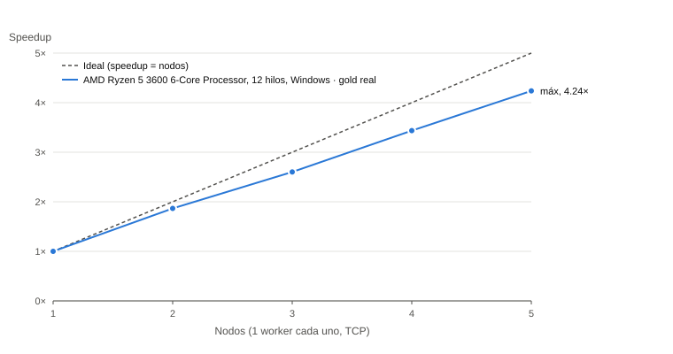

# 9. Rendimiento del clúster

## 9.1 Protocolo de medición

`go run ./cmd/benchmark -cluster -gold data/gold/train.bin` levanta en el mismo proceso un coordinador y
N nodos que hablan por TCP con el protocolo real, para N = 1 a 5. Cada nodo corre con **un worker**, como
una máquina de un núcleo; la red es la de *loopback*, así que el costo de red medido es el mínimo posible.
Por cada N se parte el gold en N shards, se descarta un entrenamiento de calentamiento (carga los shards) y
se miden cinco repeticiones. **Cada repetición se compara bit a bit con el entrenamiento secuencial antes
de registrar su tiempo**: si difiere, el benchmark falla. El tiempo por época se resume con la media
recortada y su intervalo de confianza del 95 % por *bootstrap*, y se separa en:

- **cómputo del nodo más lento**: el que dicta cuándo se cumple la barrera (si un nodo tiene varios
  shards, sus tiempos se suman, porque los calcula uno tras otro);
- **reducción** en el coordinador (`ReducirEnOrden` y `Finalizar`), que dura decenas de microsegundos;
- **red y espera**: el resto de la época, que incluye enviar los pesos, la serialización JSON, la
  transmisión y la espera en la barrera;
- **JSON del shard más pesado**, medido aparte, que es la parte de la serialización que cae en el camino
  crítico.

La fracción serial se estima con la métrica de Karp y Flatt (1990), donde S es el *speedup* con p nodos:

$$e = \frac{1/S - 1/p}{1 - 1/p}$$

Si e crece con p, el límite es la comunicación y no el cómputo.

## 9.2 Resultados

<!-- generado:cluster -->
| Nodos | ms por época (IC 95 %) | Speedup | Eficiencia | Karp-Flatt | Cómputo del nodo más lento (ms) | Red y espera (ms) | JSON del shard más pesado (ms) | KB por época |
|---:|---|---:|---:|---:|---:|---:|---:|---:|
| 1 | 72,35 (70,91–76,89) | 1,00 | 1,00 | — | 70,85 | 2,36 | 1,961 | 112,5 |
| 2 | 40,79 (40,57–41,04) | 1,77 | 0,89 | 0,128 | 39,50 | 1,29 | 1,055 | 113,3 |
| 3 | 25,67 (23,94–28,30) | 2,82 | 0,94 | 0,032 | 24,97 | 0,90 | 0,646 | 114,1 |
| 4 | 18,49 (18,22–18,79) | 3,91 | 0,98 | 0,007 | 17,84 | 0,64 | 0,502 | 114,8 |
| 5 | 15,06 (14,89–15,70) | 4,80 | 0,96 | 0,010 | 14,69 | 0,51 | 0,418 | 115,6 |

Fuente: `reports/bench_cluster_deez_gold.json` (AMD Ryzen 7 5800X 8-Core Processor, 16 hilos, Windows, go1.26.10; 5 repeticiones de 30 épocas por número de nodos, 1 worker por nodo; cada repetición verificada bit a bit contra el secuencial).
<!-- /generado -->

## 9.3 Análisis

- **La época está dominada por el cómputo.** En todas las configuraciones, el cómputo del nodo más lento
  ocupa casi toda la época; la red y la espera son unos pocos milisegundos o menos. Por eso el *speedup*
  crece casi en línea con los nodos y la eficiencia se mantiene alta.
- **El tráfico no crece con los nodos.** Cada época viaja un parcial por bloque, y el número de bloques es
  fijo (depende de las filas, no de los nodos); con más nodos solo se agrega el envío de los pesos, que
  pesan poco. Por eso los bytes por época casi no cambian.
- **La fracción serial es baja y no crece.** Karp-Flatt se mantiene en unas centésimas: lo que no se
  reparte (difundir los pesos, la barrera y la reducción) es pequeño frente al cómputo. Por la ley de
  Amdahl (Amdahl, 1967), es esa fracción la que pone el techo al *speedup* cuando se agregan nodos. La eficiencia baja
  levemente porque ese costo fijo pesa más cuando la época se acorta.
- **El límite, en una sola máquina.** Los nodos comparten la CPU del equipo, así que a partir de tantos
  nodos como núcleos físicos el *speedup* deja de crecer; en un clúster real cada nodo tendría su propia
  máquina y la red agregaría latencia, pero el tráfico por época seguiría siendo del mismo orden.
