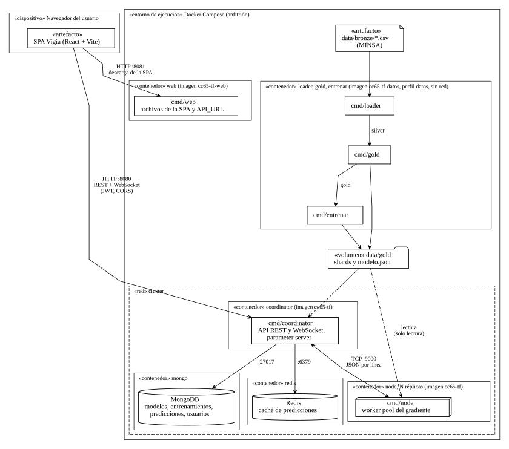

# 4. Arquitectura de la solución

## 4.1 Vista general

La @fig:arquitectura muestra dónde se ejecuta cada componente y cómo se comunican.

<!-- pendiente: bloque 2 del informe (#71) — análisis de la vista y comparación con la Fig. 1 del enunciado -->

{#fig:arquitectura}

Nota: Diagrama de despliegue UML 2.5. «contenedor» es un servicio de Docker Compose y la imagen de la que se crea. Las flechas continuas con puerto son conexiones de red, en el sentido de la petición; la de doble punta entre el coordinador y los nodos es una conexión TCP persistente por la que viajan mensajes en los dos sentidos (la abre cada nodo al registrarse). Las flechas sin puerto son lectura o escritura de archivos: del CSV a la Parte A y de la Parte A al volumen; las discontinuas, lectura del volumen en solo lectura. Fuente: `deploy/docker-compose.yml` y `deploy/docker-compose.api.yml`; diagrama en `docs/informe/tb2/diagramas/arquitectura.dot`.

## 4.2 Componentes, responsabilidades y tecnologías

<!-- pendiente: bloque 2 del informe (#71) -->

## 4.3 Flujo de datos de punta a punta

<!-- pendiente: bloque 2 del informe (#71) -->

## 4.4 Restricciones del trabajo y cómo se cumplen

<!-- pendiente: bloque 2 del informe (#71) -->

## 4.5 Requisitos del enunciado y archivos del repositorio

<!-- pendiente: bloque 2 del informe (#71) -->
