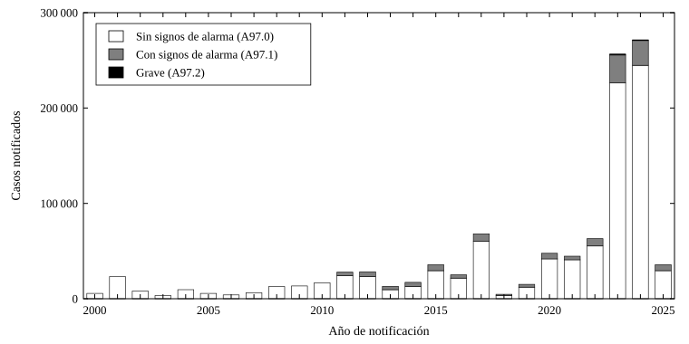

# 6. Datos: perfil del conjunto original (capa bronze)

Antes de limpiar los datos se midió cómo vienen: cuántas filas tiene el archivo, qué columnas trae, cuántos vacíos tiene cada una y cómo se reparten los casos por año y por clase. Ese perfil lo calcula `cmd/perfil` con el mismo patrón concurrente que el cargador (sección 7.3) y queda en `reports/perfil_bronze.json`, del que salen todas las cifras de esta sección.

## 6.1 Fuente

El archivo es el de la Plataforma Nacional de Datos Abiertos (Ministerio de Salud del Perú, s.f.): `<!--v:.S.P.Archivo-->vigilancia_dengue_2000_2025.csv<!--/v-->`, de <!--v:mb .S.P.Bytes-->117,9<!--/v--> MB y <!--v:miles .S.P.Perfil.Filas-->1 065 274<!--/v--> filas, cada una un caso de dengue notificado a la Red Nacional de Epidemiología entre <!--v:.S.AnoMin-->2000<!--/v--> y <!--v:.S.AnoMax-->2025<!--/v-->. Su huella SHA-256 (`<!--v:.S.P.SHA256-->7865e8b2f5a7aef1e8dce159444891f2c2e59b311d574f28c55aaca5a9abb8ba<!--/v-->`) se registra en `data/MANIFEST.sha256`: `make data` la comprueba en cada descarga, así que el informe y las mediciones se refieren siempre al mismo archivo. Solo <!--v:miles .S.P.Perfil.FilasMalas-->85<!--/v--> filas están mal formadas: <!--v:miles .S.P.Perfil.ErrComill-->85<!--/v--> por comillas sin escapar dentro de un campo de texto y <!--v:miles .S.P.Perfil.ErrColum-->0<!--/v--> por número de columnas; la sección 7.1 explica cómo se recuperan.

## 6.2 Variables

El archivo tiene quince columnas (@tab:columnas). Las que usa el modelo (departamento, año, semana, edad, tipo de edad y sexo) no tienen vacíos. Los vacíos se concentran en `localidad` y `localcod`, que el modelo no usa: el nivel geográfico del análisis es el departamento, que es donde se decide la distribución de camas y personal. La columna `enfermedad` y su código CIE-10 `diagnostic` contienen la misma información; de ellas sale la variable objetivo.

<!-- generado:plantilla:variables -->
Tabla: Columnas del archivo original: vacíos, valores distintos y valores más frecuentes {#tab:columnas}

| Columna | Vacíos | Valores distintos | Valores más frecuentes (casos) |
|---|---:|---:|---|
| `departamento` | 0 | 23 | PIURA (239078); LIMA (124514); LORETO (113103) |
| `provincia` | 0 | 124 | PIURA (113982); LIMA (107710); MAYNAS (73793) |
| `distrito` | 0 | 625 | PIURA (40003); IQUITOS (31023); SULLANA (29913) |
| `localidad` | 53 909 | 10 378 | NULL (69726); (vacío) (53909); IQUITOS (21475) |
| `enfermedad` | 0 | 3 | DENGUE SIN SIGNOS DE ALARMA (944608); DENGUE CON SIGNOS DE ALARMA (116384); DENGUE GRAVE (4197) |
| `ano` | 0 | 26 | 2024 (271531); 2023 (256600); 2017 (68290) |
| `semana` | 0 | 53 | 16 (51401); 15 (48317); 18 (47713) |
| `diagnostic` | 0 | 3 | A97.0 (944608); A97.1 (116384); A97.2 (4197) |
| `tipo_dx` | 0 | 2 | C (955057); P (110132) |
| `diresa` | 23 | 33 | 32 (122429); 16 (113102); 31 (104690) |
| `ubigeo` | 0 | 662 | 200101 (40003); 160101 (31023); 200601 (29913) |
| `localcod` | 149 626 | 10 210 | (vacío) (149626); 0 (25605); 1601010001 (20079) |
| `edad` | 0 | 123 | 15 (25523); 14 (25322); 16 (24876) |
| `tipo_edad` | 0 | 3 | A (1058214); M (6644); D (331) |
| `sexo` | 0 | 2 | F (572164); M (493025) |

Nota: Perfil de las 1 065 274 filas del archivo `vigilancia_dengue_2000_2025.csv`. Fuente: `reports/perfil_bronze.json`, generado por `cmd/perfil`.
<!-- /generado -->

## 6.3 Distribución por año y clase

La @fig:casos-ano y la @tab:clase-ano muestran tres cosas que condicionan el diseño:

1. **Las epidemias de 2023 y 2024 dominan el archivo.** Esos dos años suman <!--v:miles (add (total (index .S.P.Perfil.PorAno "2023")) (total (index .S.P.Perfil.PorAno "2024")))-->528 131<!--/v--> casos, casi la mitad de las filas. Un modelo entrenado con todos los años aprende sobre todo de esas dos temporadas; por eso la evaluación (sección 17) separa entrenamiento y prueba al azar y no por año.
2. **La clase «con signos de alarma» empieza en 2011.** Hasta 2010 casi todos los casos se registran como «sin signos»: la clasificación de la OMS de 2009 (WHO, 2009) se adoptó después. Si esos años entraran al entrenamiento, el modelo aprendería que el año predice la clase, cuando lo que cambió fue la forma de registrar. Por eso el modelo usa los casos desde <!--v:.S.M.S.AnoMin-->2011<!--/v-->, mientras que la carga y la limpieza procesan todas las filas.
3. **La proporción de casos con signos de alarma o graves varía entre años**: desde 2011 va de <!--v:tasaAno (index .S.P.Perfil.PorAno "2021")-->8,7<!--/v--> % en 2021 a <!--v:tasaAno (index .S.P.Perfil.PorAno "2013")-->27,1<!--/v--> % en 2013. Los datos no dicen por qué; una explicación posible es que en años con pocos casos se notifiquen sobre todo los más evidentes. El modelo incluye el año como tendencia para absorber ese cambio.

{#fig:casos-ano}

Nota: Barras apiladas: sin signos de alarma (blanco), con signos de alarma (gris) y grave (negro). Fuente: MINSA y CDC Perú, Plataforma Nacional de Datos Abiertos; elaboración propia con `reports/perfil_bronze.json`.

<!-- generado:plantilla:clase-ano -->
Tabla: Casos notificados por año y clasificación clínica {#tab:clase-ano}

| Año | Sin signos (A97.0) | Con signos (A97.1) | Grave (A97.2) | Total | Con signos o grave (%) |
|---|---:|---:|---:|---:|---:|
| 2000 | 5 557 | 0 | 0 | 5 557 | 0,0 |
| 2001 | 23 276 | 0 | 250 | 23 526 | 1,1 |
| 2002 | 8 071 | 1 | 14 | 8 086 | 0,2 |
| 2003 | 3 334 | 0 | 15 | 3 349 | 0,4 |
| 2004 | 9 512 | 0 | 34 | 9 546 | 0,4 |
| 2005 | 5 625 | 0 | 15 | 5 640 | 0,3 |
| 2006 | 4 018 | 0 | 4 | 4 022 | 0,1 |
| 2007 | 6 309 | 0 | 35 | 6 344 | 0,6 |
| 2008 | 12 789 | 0 | 35 | 12 824 | 0,3 |
| 2009 | 13 396 | 0 | 11 | 13 407 | 0,1 |
| 2010 | 16 669 | 134 | 39 | 16 842 | 1,0 |
| 2011 | 24 400 | 3 508 | 176 | 28 084 | 13,1 |
| 2012 | 23 444 | 4 860 | 199 | 28 503 | 17,7 |
| 2013 | 9 540 | 3 477 | 72 | 13 089 | 27,1 |
| 2014 | 12 939 | 4 203 | 92 | 17 234 | 24,9 |
| 2015 | 29 385 | 6 308 | 123 | 35 816 | 18,0 |
| 2016 | 21 656 | 3 381 | 123 | 25 160 | 13,9 |
| 2017 | 60 389 | 7 667 | 234 | 68 290 | 11,6 |
| 2018 | 3 523 | 1 111 | 64 | 4 698 | 25,0 |
| 2019 | 12 174 | 2 955 | 158 | 15 287 | 20,4 |
| 2020 | 41 821 | 5 883 | 225 | 47 929 | 12,7 |
| 2021 | 40 874 | 3 767 | 129 | 44 770 | 8,7 |
| 2022 | 55 285 | 7 707 | 212 | 63 204 | 12,5 |
| 2023 | 226 454 | 29 129 | 1 017 | 256 600 | 11,7 |
| 2024 | 244 743 | 26 052 | 736 | 271 531 | 9,9 |
| 2025 | 29 425 | 6 241 | 185 | 35 851 | 17,9 |

Nota: Fuente: `reports/perfil_bronze.json` (`por_ano_y_clase`).
<!-- /generado -->

En el total del archivo hay <!--v:miles .S.P.Neg-->944 608<!--/v--> casos sin signos y <!--v:miles .S.P.Pos-->120 581<!--/v--> con signos de alarma o graves (<!--v:pct .S.P.Tasa-->11,32<!--/v--> %): las clases están desbalanceadas, y la sección 8.2 explica cómo se compensa.

## 6.4 Edad por etapa de vida

La edad viene en años, meses o días según `tipo_edad`; el perfil la normaliza a años y la agrupa en las etapas de vida que usa el MINSA (@tab:etapas). Los adultos de 30 a 59 años son el grupo con más casos, pero no el de mayor riesgo por caso (sección 18.3): por eso el modelo usa la etapa como variable propia, además de la edad continua.

<!-- generado:plantilla:etapas -->
Tabla: Casos por etapa de vida del MINSA {#tab:etapas}

| Etapa de vida | Casos |
|---|---:|
| niño (0–11 años) | 176 747 |
| adolescente (12–17 años) | 146 780 |
| joven (18–29 años) | 247 590 |
| adulto (30–59 años) | 400 993 |
| adulto mayor (60 años a más) | 93 079 |

Nota: La edad se normaliza a años según `tipo_edad` (A = años, M = meses, D = días). Filas con edad no numérica o `tipo_edad` desconocido: 0. Fuente: `reports/perfil_bronze.json`.
<!-- /generado -->

## 6.5 Cálculo concurrente del perfil

El perfil recorre el archivo completo, así que usa el mismo esquema que el cargador: el archivo se lee en memoria, se parte en <!--v:.S.P.Bloques-->113<!--/v--> bloques de bytes que terminan en un fin de línea y un *worker pool* calcula los conteos de cada bloque en su propio *slot*; al final se combinan en orden de bloque. Con <!--v:.S.P.Workers-->2<!--/v--> workers tardó <!--v:seg .S.P.SegConc-->0,609<!--/v--> s frente a <!--v:seg .S.P.SegSec-->1,112<!--/v--> s con uno (*speedup* de <!--v:dos .S.P.Speedup-->1,83<!--/v-->), y el resultado es idéntico al secuencial: <!--v:sino .S.P.Equivale-->sí<!--/v-->, comprobado por el propio `cmd/perfil`.
