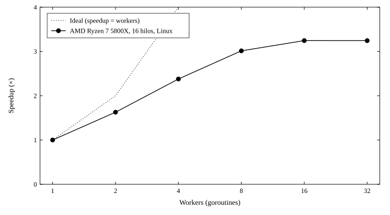

# 7. Parte A: carga y limpieza concurrente

La Parte A convierte el CSV del MINSA (bronze) en filas limpias y validadas (silver) y luego en la matriz numérica que usa el modelo (gold). La limpieza recorre más de un millón de filas, así que es la parte del sistema que el enunciado exige procesar de forma concurrente. Esta sección muestra qué reglas aplica (7.1), qué queda en cada capa (7.2), cómo se reparte el trabajo entre goroutines (7.3 y 7.4), la evidencia de una ejecución (7.5) y cuánto se acelera (7.6).

## 7.1 Reglas de limpieza y validación

`cmd/loader` evalúa cada fila contra las reglas de la @tab:reglas, en ese orden, y la descarta por la **primera** que incumple; así cada fila descartada se cuenta una sola vez y la suma de la tabla es el total de filas perdidas. Las reglas solo descartan lo que haría fallar o engañaría al modelo: un departamento o un sexo fuera del catálogo, una semana fuera de 1–53, una edad no numérica o imposible, o una clasificación clínica que no es ninguna de las tres de dengue.

<!-- generado:plantilla:reglas-limpieza -->
Tabla: Reglas de validación en el orden en que se aplican y filas que descarta cada una {#tab:reglas}

| # | Regla | Filas descartadas |
|---:|---|---:|
| 1 | mal_formada (columnas ≠ 15 aun reparando comillas) | 0 |
| 2 | diagnostico fuera de A97.0/A97.1/A97.2 | 0 |
| 3 | enfermedad no coincide con el código CIE-10 | 0 |
| 4 | año fuera de 2000–2025 | 0 |
| 5 | semana epidemiológica fuera de 1–53 | 0 |
| 6 | edad no numérica, negativa o tipo_edad ∉ {A,M,D} | 0 |
| 7 | edad mayor a 110 años | 14 |
| 8 | sexo ∉ {F,M} | 0 |
| 9 | tipo_dx ∉ {C,P} | 0 |
| 10 | ubigeo no numérico o de largo ≠ 5/6 | 0 |
| 11 | departamento vacío | 0 |
| | **Total** | **14** |

Nota: Cada fila se descarta por la primera regla que incumple, así que se cuenta una sola vez. Fuente: `reports/limpieza.json`, generado por `cmd/loader`.
<!-- /generado -->

Además de descartar, el cargador **repara** sin perder filas, porque los errores son de formato y no de contenido:

- **Comillas sin escapar.** <!--v:miles .S.L.L.Reparadas-->85<!--/v--> filas traen comillas dentro del campo `localidad` (por ejemplo `"ISLA SANTA ROSA "AMAZONAS""`), que el estándar CSV no admite. Se recuperan con un segundo intento de lectura que trata esas comillas como texto (`ParsearLineaTolerante`).
- **Ubigeo de cinco dígitos.** Si el código de ubicación llega sin su cero inicial (lo que ocurre cuando una hoja de cálculo lo convierte en número), se rellena; en el archivo actual la regla se aplicó a <!--v:miles .S.L.L.Corregidas-->0<!--/v--> filas, y se mantiene como protección para futuras versiones del archivo.
- **Edad en distintas unidades.** Se normaliza a años según `tipo_edad`: A = años, M = meses / 12, D = días / 365.

**Filas idénticas.** <!--v:miles .S.L.L.Identicas-->148 787<!--/v--> filas repiten exactamente a otra y **no se eliminan**. El dataset no tiene un identificador de paciente, y dos casos reales pueden coincidir en todos los campos: misma localidad, semana, edad y sexo, algo esperable en un brote. Eliminarlas borraría casos verdaderos y bajaría artificialmente la carga en los lugares con más casos, que son justo los que el sistema debe señalar.

## 7.2 Capas bronze, silver y gold

Los datos pasan por tres capas (*medallion*), y cada una se puede regenerar desde la anterior con un comando (@tab:capas). La capa silver es un CSV normalizado (`data/silver/dengue.csv`) que conserva las columnas originales; la gold son archivos binarios de `float64`, una fila por caso y una columna por variable, listos para el cálculo del gradiente sin volver a parsear texto.

<!-- generado:plantilla:capas -->
Tabla: Filas en cada capa de datos {#tab:capas}

| Capa | Contenido | Filas |
|---|---|---:|
| Bronze | CSV original del MINSA, sin tocar | 1 065 274 |
| Silver | Filas válidas y normalizadas (`data/silver/dengue.csv`) | 1 065 260 |
| Gold: entrenamiento | Matriz numérica desde 2011, partida en 3 shards | 765 297 |
| Gold: prueba | Matriz numérica para la evaluación (sección 17) | 190 819 |

Nota: Entre silver y gold quedan fuera 109 144 filas anteriores a 2011 (sección 2.4). Fuente: `reports/limpieza.json` y `reports/split.json`.
<!-- /generado -->

El conjunto que entrena el modelo tiene <!--v:miles .S.M.S.Train.Filas-->765 297<!--/v--> filas: supera el millón de registros que pide el enunciado en la carga y la limpieza, y se reduce después solo por la decisión de usar los años con la clasificación vigente (sección 6.3).

## 7.3 Diseño concurrente: bloques de bytes, *worker pool* y canales

El archivo completo se lee en memoria (unos 118 MB, menos de una décima de segundo) y se parte en bloques de aproximadamente 1 MiB. El corte de cada bloque se corre hasta el siguiente fin de línea, así que ninguna fila queda partida entre dos bloques, y los límites dependen solo del contenido del archivo, **no del número de workers**: con 1, 2 o 16 workers se procesan exactamente los mismos <!--v:.S.L.Bloques-->113<!--/v--> bloques.

<!-- generado:fuente:internal/ingest/bloques.go#PartirEnBloques -->
```go
// internal/ingest/bloques.go
// PartirEnBloques corta datos en bloques de ~tam bytes que terminan en '\n'.
// Ninguna línea queda partida entre dos bloques.
func PartirEnBloques(datos []byte, tam int) []Rango {
	if tam <= 0 {
		tam = TamBloqueBytesPorDefecto
	}
	var rangos []Rango
	for ini := 0; ini < len(datos); {
		fin := ini + tam
		if fin >= len(datos) {
			fin = len(datos)
		} else if j := bytes.IndexByte(datos[fin:], '\n'); j >= 0 {
			fin += j + 1
		} else {
			fin = len(datos)
		}
		rangos = append(rangos, Rango{ini, fin})
		ini = fin
	}
	return rangos
}
```
<!-- /generado -->

`MapearEnOrden` reparte los bloques. Un canal sin búfer (`tareas`) entrega índices de bloque a un número fijo de goroutines; cada una procesa el bloque que recibe y escribe el resultado en `res[k]`, el *slot* de ese bloque, que ninguna otra goroutine toca. Cuando el canal se cierra y el `WaitGroup` llega a cero, todos los resultados están en su lugar y el llamador los recorre **en orden de bloque**. Por eso el silver concurrente es idéntico byte a byte al secuencial, y lo comprueba el propio cargador comparando la huella SHA-256 de los dos resultados.

<!-- generado:fuente:internal/ingest/bloques.go#MapearEnOrden -->
```go
// internal/ingest/bloques.go
// MapearEnOrden aplica f a cada bloque con un worker pool y devuelve los
// resultados en orden de bloque.
//
// Sincronización: un canal reparte índices de bloque; cada worker escribe solo
// en res[k] (slot propio, sin mutex); WaitGroup marca el fin. El llamador
// recibe res cuando todos terminaron, así que lo puede leer sin carreras.
func MapearEnOrden[T any](datos []byte, rangos []Rango, workers int, f func(k int, bloque []byte) T) []T {
	res := make([]T, len(rangos))
	workers = max(1, min(workers, len(rangos)))
	if workers == 1 {
		for k, r := range rangos {
			res[k] = f(k, datos[r.Ini:r.Fin])
		}
		return res
	}
	tareas := make(chan int)
	var wg sync.WaitGroup
	wg.Add(workers)
	for range workers {
		go func() {
			defer wg.Done()
			for k := range tareas {
				r := rangos[k]
				res[k] = f(k, datos[r.Ini:r.Fin])
			}
		}()
	}
	for k := range rangos {
		tareas <- k
	}
	close(tareas)
	wg.Wait()
	return res
}
```
<!-- /generado -->

## 7.4 Patrones de concurrencia aplicados

La @tab:patrones-carga indica, para cada patrón, en qué línea del código está y **cómo** se aplica, que es lo que pidió la retroalimentación de la PC2.

Tabla: Patrones de concurrencia de la Parte A y cómo se aplica cada uno {#tab:patrones-carga}

| Patrón | Dónde | Cómo se aplica | Qué evita |
|---|---|---|---|
| Descomposición de datos en bloques | `PartirEnBloques` | Bloques de tamaño objetivo fijo, alineados a fin de línea; el número de bloques no depende de los workers | Que el resultado cambie con el número de workers |
| *Worker pool* | `MapearEnOrden` | `workers` goroutines creadas una vez, que toman bloques hasta que se cierra el canal | Crear una goroutine por fila o por bloque |
| *Fan-out* por canal | `tareas chan int` | El hilo principal envía los índices 0 … B − 1; cada índice lo recibe un solo worker | Que dos workers procesen el mismo bloque |
| Acumulador privado por bloque | `res[k]` | Cada worker escribe solo en el *slot* del bloque que recibió | Mutex y condiciones de carrera sobre un resultado compartido |
| Barrera | `sync.WaitGroup` | `wg.Wait()` espera a que terminen todos los workers antes de leer `res` | Leer resultados incompletos |
| *Fan-in* ordenado | El recorrido de `res` por índice | Se concatenan las salidas de los bloques en orden 0 … B − 1 | Que el orden de las filas dependa de quién terminó primero |

Nota: Elaboración propia. Los mismos patrones se repiten en el cálculo del gradiente (sección 8.3) y en el clúster (sección 9). `go test -race ./internal/ingest` los ejecuta con el detector de carreras en cada Pull Request.

## 7.5 Evidencias

La ejecución de la Parte A en Docker, con el archivo real, está en la sección 5.7: los tres servicios terminan con código 0 y dejan el silver y el gold. El cargador además escribe `reports/limpieza.json`, del que salen las tablas de esta sección; se reproduce completo porque registra a la vez el resultado de la limpieza, la huella del silver y la comparación con la versión secuencial:

<!-- generado:archivo:reports/limpieza.json -->
```json
{
  "generado": "2026-10-24T16:00:59-05:00",
  "entrada": "vigilancia_dengue_2000_2025.csv",
  "sha256_entrada": "7865e8b2f5a7aef1e8dce159444891f2c2e59b311d574f28c55aaca5a9abb8ba",
  "silver": "data/silver/dengue.csv",
  "sha256_silver": "192f2824eb06a158f02776011f524598d850b3e6b505114dbe159778926888f7",
  "workers": 2,
  "bloques": 113,
  "seg_lectura_disco": 0.062576747,
  "seg_limpieza_secuencial": 0.891695105,
  "seg_limpieza_concurrente": 0.478711038,
  "speedup": 1.8627001138837331,
  "silver_concurrente_igual_al_secuencial": true,
  "limpieza": {
    "filas_entrada": 1065274,
    "filas_salida": 1065260,
    "filas_descartadas": 14,
    "descartadas_por_regla": {
      "año fuera de 2000–2025": 0,
      "departamento vacío": 0,
      "diagnostico fuera de A97.0/A97.1/A97.2": 0,
      "edad mayor a 110 años": 14,
      "edad no numérica, negativa o tipo_edad ∉ {A,M,D}": 0,
      "enfermedad no coincide con el código CIE-10": 0,
      "mal_formada (columnas ≠ 15 aun reparando comillas)": 0,
      "semana epidemiológica fuera de 1–53": 0,
      "sexo ∉ {F,M}": 0,
      "tipo_dx ∉ {C,P}": 0,
      "ubigeo no numérico o de largo ≠ 5/6": 0
    },
    "ubigeo_rellenado_con_cero": 0,
    "comillas_sin_escapar_reparadas": 85,
    "positivos": 120601,
    "tasa_positivos": 0.11321273679665059,
    "filas_identicas_conservadas": 148787,
    "orden_reglas": [
      "mal_formada (columnas ≠ 15 aun reparando comillas)",
      "diagnostico fuera de A97.0/A97.1/A97.2",
      "enfermedad no coincide con el código CIE-10",
      "año fuera de 2000–2025",
      "semana epidemiológica fuera de 1–53",
      "edad no numérica, negativa o tipo_edad ∉ {A,M,D}",
      "edad mayor a 110 años",
      "sexo ∉ {F,M}",
      "tipo_dx ∉ {C,P}",
      "ubigeo no numérico o de largo ≠ 5/6",
      "departamento vacío"
    ]
  }
}
```
<!-- /generado -->

Los campos que sustentan esta sección son `limpieza.descartadas_por_regla` (@tab:reglas), `filas_entrada`, `filas_salida` y `filas_identicas_conservadas` (sección 7.1 y @tab:capas) y `silver_concurrente_igual_al_secuencial`: `true` significa que el silver de <!--v:.S.L.Workers-->2<!--/v--> workers tiene la misma huella SHA-256 que el de uno.

## 7.6 Rendimiento secuencial y concurrente, y punto de equilibrio

`cmd/loader -bench` mide la limpieza completa del archivo en memoria, sin la lectura del disco, con 1 a <!--v:(index .LoaderRef.Mediciones 5).Workers-->32<!--/v--> workers (el doble de las CPU lógicas), en orden barajado y con varias repeticiones por configuración (@tab:bench-loader y @fig:speedup-loader). En cada repetición comprueba que el silver sea igual al secuencial.

<!-- generado:plantilla:bench-loader -->
Tabla: Tiempo de la limpieza del archivo completo según el número de workers {#tab:bench-loader}

| Workers | Media recortada (ms) | IC 95 % (ms) | Speedup | Eficiencia (%) | Filas por segundo | Silver igual al secuencial |
|---:|---:|---|---:|---:|---:|:---:|
| 1 | 546,5 | [541,6; 551,8] | 1,00 | 100,00 | 1 949 330 | sí |
| 2 | 335,6 | [332,2; 340,8] | 1,63 | 81,41 | 3 173 906 | sí |
| 4 | 229,8 | [227,4; 232,2] | 2,38 | 59,46 | 4 636 178 | sí |
| 8 | 181,4 | [179,7; 182,9] | 3,01 | 37,67 | 5 874 015 | sí |
| 16 | 168,4 | [167,2; 169,8] | 3,25 | 20,28 | 6 326 025 | sí |
| 32 | 168,5 | [166,8; 170,4] | 3,24 | 10,14 | 6 323 930 | sí |

Nota: AMD Ryzen 7 5800X 8-Core Processor, 16 CPU lógicas, linux. Limpieza en memoria (sin la lectura del disco), un calentamiento, repeticiones en orden barajado, `runtime.GC()` antes de cada medición, media recortada al 10 % e intervalo de confianza por *bootstrap*. Fuente: `reports/bench_loader_deez-wsl-debian.json`.
<!-- /generado -->

{#fig:speedup-loader}

Nota: Escala logarítmica en base 2 en el eje horizontal; la línea punteada es el *speedup* ideal (igual al número de workers). Fuente: `reports/<!--v:.LoaderRef.Archivo-->bench_loader_deez-wsl-debian.json<!--/v-->`.

**Análisis.** El *speedup* crece con los primeros workers y luego se aplana. La limpieza de cada fila es barata (parsear unos 15 campos y validarlos), así que, a medida que se agregan workers, pesan más las partes que no se reparten: recorrer los resultados en orden, escribir el silver y el ancho de banda de memoria, que comparten todos los núcleos. La eficiencia (*speedup* dividido entre workers) baja por eso.

**Punto de equilibrio.** Paralelizar tiene un costo fijo: crear las goroutines, partir el archivo y coordinarlas. Solo conviene cuando el trabajo de cada bloque supera ese costo. En este archivo ya conviene desde dos workers, porque cada bloque tiene unas 9 000 filas; con archivos de pocas miles de filas el costo fijo dominaría y la versión secuencial sería igual o más rápida. Pasados los núcleos físicos la ganancia es pequeña (los hilos de un mismo núcleo comparten sus unidades de cálculo), y más allá de las CPU lógicas de la máquina (nota de la @tab:bench-loader) un worker adicional ya no aporta nada, porque solo espera turno: ahí la curva de la @fig:speedup-loader se aplana del todo. La sección 8.5 mide el mismo punto de equilibrio en función del tamaño de los datos para el cálculo del gradiente, donde el trabajo por fila es mayor.
