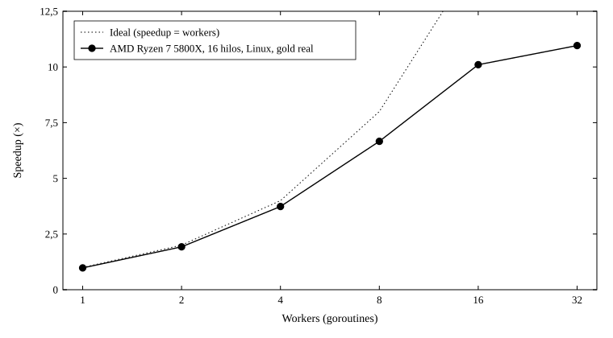

# 8. Parte B: modelo de aprendizaje automático

El modelo estima, para un caso recién notificado, la probabilidad de que sea **dengue con signos de alarma o grave**, la forma que requiere observación u hospitalización (sección 2). Se eligió la regresión logística porque su gradiente es una suma sobre filas, lo que permite partir el cálculo entre goroutines y entre máquinas sin cambiar el resultado (ADR-0001), y porque sus pesos se interpretan directamente como razones de odds, algo necesario para que un responsable de salud entienda por qué el modelo señala un departamento o una semana. Esta sección describe las variables (8.1), la formulación (8.2), cómo se paraleliza el cálculo dentro de un nodo (8.3), por qué el resultado es idéntico bit a bit al secuencial (8.4) y cuánto se acelera (8.5). Las métricas del modelo y la respuesta a la pregunta de impacto se presentan en las secciones 17 y 18.

## 8.1 Variables y codificación

**Años usados.** El modelo se entrena con los casos desde <!--v:.S.M.S.AnoMin-->2011<!--/v-->, cuando la clasificación con signos de alarma ya se aplica de forma sistemática (sección 6.3). Quedan fuera <!--v:miles .S.M.S.FilasExcluidas-->109 144<!--/v--> de las <!--v:miles .S.M.S.FilasSilver-->1 065 260<!--/v--> filas del silver; incluirlas enseñaría al modelo que antes de esa fecha casi no había casos con signos de alarma, cuando lo que cambió fue la forma de clasificarlos.

**Variables.** Solo se usan datos que se conocen en el momento de notificar el caso, porque el sistema debe servir para decidir antes de que el caso evolucione. Son <!--v:.S.M.S.D-->31<!--/v--> variables (@tab:variables-modelo). La codificación sigue el ADR-0004.

Tabla: Variables del modelo y su codificación {#tab:variables-modelo}

| Grupo | Columnas | Codificación | Por qué |
|---|---:|---|---|
| Edad | 1 | Años estandarizados (*z-score*) | Da la tendencia general con la edad |
| Etapa de vida (MINSA) | 5 | *One-hot*: niño, adolescente, joven, adulto, adulto mayor | Captura la forma no lineal del riesgo, mayor en los extremos de la vida |
| Sexo | 1 | 1 si es masculino | Diferencia de riesgo entre sexos |
| Semana epidemiológica | 2 | sen(2π(s − 1)/52) y cos(2π(s − 1)/52) | La semana 52 queda junto a la semana 1: la estacionalidad es cíclica |
| Año | 1 | Estandarizado | Tendencia en el tiempo; a diferencia de un *one-hot*, permite predecir años futuros |
| Departamento | <!--v:add .S.M.S.D -10-->21<!--/v--> | *One-hot*; los de menos de 100 casos en entrenamiento se agrupan en `OTROS` | Diferencias territoriales; agrupar evita columnas casi vacías |

Nota: Elaboración propia a partir de `internal/features` y del ADR-0004. Las medias y desviaciones de la edad y del año se calculan solo con el conjunto de entrenamiento, para que el conjunto de prueba no influya en el modelo.

**Variable excluida a propósito.** `tipo_dx` (caso confirmado o probable) no entra al modelo. Los casos graves se confirman en laboratorio con más frecuencia, de modo que esa columna depende del desenlace que se quiere predecir: usarla inflaría las métricas sin mejorar la decisión real (fuga de información del objetivo).

**Conjuntos de entrenamiento y de prueba.** Cada fila se asigna a prueba según un *hash* de su posición, no según el orden en que la procesa un worker (@tab:split). Así el reparto es el mismo con cualquier número de workers o de nodos, y la proporción de casos positivos queda prácticamente igual en ambos conjuntos sin necesidad de estratificar.

<!-- generado:plantilla:split -->
Tabla: Conjuntos de entrenamiento y de prueba {#tab:split}

| Conjunto | Filas | Con signos o grave | Proporción (%) |
|---|---:|---:|---:|
| Entrenamiento | 765 297 | 96 012 | 12,55 |
| Prueba | 190 819 | 24 002 | 12,58 |

Nota: Cada fila va a prueba según un *hash* (splitmix64) de su posición en el silver, con probabilidad 20,00 %: el reparto no depende del número de workers ni de nodos. Fuente: `reports/split.json`, generado por `cmd/gold`.
<!-- /generado -->

## 8.2 Formulación del modelo

Para el caso *i*, con vector de variables $x_i$, la regresión logística calcula el puntaje $z_i = x_i^\top w + b$ y la probabilidad $p_i = \sigma(z_i) = 1/(1 + e^{-z_i})$. Los pesos se obtienen minimizando la pérdida logística ponderada con regularización L2:

$$L(w, b) = \frac{1}{S}\sum_{i=1}^{n} s_i\,\big[\log(1+e^{z_i}) - y_i z_i\big] + \frac{\lambda}{2}\lVert w\rVert^2, \qquad S = \sum_{i=1}^{n} s_i$$

cuyo gradiente es

$$\nabla_w L = \frac{1}{S}\sum_{i=1}^{n} s_i\,\big(\sigma(z_i) - y_i\big)\,x_i + \lambda w, \qquad \frac{\partial L}{\partial b} = \frac{1}{S}\sum_{i=1}^{n} s_i\,\big(\sigma(z_i) - y_i\big).$$

**Pesos por clase.** Solo el <!--v:pct .S.M.S.Train.Tasa-->12,55<!--/v--> % de los casos de entrenamiento es positivo (@tab:split). Sin corrección, el modelo aprendería que casi siempre conviene responder «sin signos de alarma». El peso $s_i$ vale <!--v:tres .S.M.E.PesoPos-->3,985<!--/v--> para los positivos y <!--v:tres .S.M.E.PesoNeg-->0,572<!--/v--> para los negativos, de modo que las dos clases aportan lo mismo a la suma. Como estos pesos desplazan las probabilidades hacia arriba, al reportar riesgos se corrige el puntaje restándole $\ln(s_{+}/s_{-})$ (corrección de *prior* de King y Zeng, 2001), lo que devuelve la escala de las tasas observadas.

**Optimización.** Descenso de gradiente por lotes completos (*full-batch*): en cada época se calcula el gradiente sobre todas las filas de entrenamiento y se actualizan los pesos con $w \leftarrow w - \eta\,\nabla_w L$. Se usan <!--v:.S.M.E.Epocas-->600<!--/v--> épocas, tasa de aprendizaje $\eta$ = <!--v:num .S.M.E.Tasa-->2<!--/v--> y $\lambda$ = <!--v:num .S.M.E.Lambda-->0,0001<!--/v-->. Se eligió *full-batch* y no descenso estocástico porque hace que cada época sea una función fija de los pesos: el mismo gradiente con 1 o con 16 workers, con 1 o con 5 nodos, lo que permite comprobar la equivalencia bit a bit (8.4).

**Por qué el cálculo se puede distribuir.** El gradiente es una suma sobre filas. Si las filas se parten en bloques $B_1, \dots, B_K$, cada bloque produce su suma parcial

$$g_k = \sum_{i \in B_k} s_i\,\big(\sigma(z_i) - y_i\big)\,x_i, \qquad S_k = \sum_{i \in B_k} s_i,$$

y el gradiente total es $\nabla_w L = \frac{1}{\sum_k S_k}\sum_{k=1}^{K} g_k + \lambda w$. Cualquier worker o nodo puede calcular cualquier $g_k$ con solo conocer $w$; lo único que se reúne en un punto es la suma de los $K$ parciales. Esa es la ecuación de agregación del *parameter server* (sección 9).

En el código, `ParcialBloque` calcula $g_k$, $S_k$ y la pérdida del bloque *k*, y es la **única** función que recorre filas: la usan la versión secuencial, el *worker pool* y los nodos del clúster. `ReducirEnOrden` suma los parciales y `Finalizar` divide entre el peso total y agrega la regularización:

<!-- generado:fuente:internal/ml/logistica.go#ParcialBloque -->
```go
// internal/ml/logistica.go
// ParcialBloque calcula las sumas del bloque k en out (que se sobrescribe).
// Es la única función que toca las filas: secuencial, concurrente y
// distribuido la comparten, por eso sus resultados por bloque son idénticos.
//
// La pérdida y el peso se acumulan en variables locales (registros) y se
// escriben en out una sola vez al final: así dos goroutines que procesan
// bloques vecinos no escriben fila a fila en la misma línea de caché.
func ParcialBloque(ds *Dataset, cfg Config, w []float64, k int, out *Parcial) {
	cfg = cfg.normalizada()
	clear(out.Grad)
	ini, fin := LimitesBloque(k, ds.N, cfg.TamBloque)
	d := ds.D
	grad := out.Grad
	var perdida, peso float64
	for i := ini; i < fin; i++ {
		x := ds.Fila(i)
		y := ds.Y[i]
		s := cfg.PesoNeg
		if y == 1 {
			s = cfg.PesoPos
		}
		z := Puntaje(w, x)
		r := s * (Sigmoide(z) - y)
		for j, v := range x {
			grad[j] += r * v
		}
		grad[d] += r
		perdida += s * perdidaLogistica(z, y)
		peso += s
	}
	out.Perdida, out.Peso = perdida, peso
}
```
<!-- /generado -->

<!-- generado:fuente:internal/ml/logistica.go#ReducirEnOrden -->
```go
// internal/ml/logistica.go
// ReducirEnOrden acumula los parciales en el orden del slice (índice de bloque).
// Este orden fijo es lo que garantiza el determinismo bit a bit.
func ReducirEnOrden(parciales []Parcial, d int) Parcial {
	total := NuevoParcial(d)
	for k := range parciales {
		total.Acumular(&parciales[k])
	}
	return total
}
```
<!-- /generado -->

<!-- generado:fuente:internal/ml/logistica.go#Finalizar -->
```go
// internal/ml/logistica.go
// Finalizar normaliza por el peso total y agrega la regularización L2.
func Finalizar(total Parcial, cfg Config, w []float64) Gradiente {
	d := len(w) - 1
	g := Gradiente{Grad: make([]float64, d+1)}
	var norma2 float64
	for j := 0; j < d; j++ {
		g.Grad[j] = total.Grad[j]/total.Peso + cfg.Lambda*w[j]
		norma2 += w[j] * w[j]
	}
	g.Grad[d] = total.Grad[d] / total.Peso
	g.Perdida = total.Perdida/total.Peso + 0.5*cfg.Lambda*norma2
	return g
}
```
<!-- /generado -->

## 8.3 Paralelización dentro del nodo

Cada época se calculan <!--v:.S.M.S.Bloques-->187<!--/v--> bloques de <!--v:.S.M.S.TamBloque-->4096<!--/v--> filas. `ml.Pool` los reparte entre un número fijo de goroutines que se crean una sola vez y viven todo el entrenamiento (@fig:worker-pool). Crearlas en cada época costaría poco frente al cálculo de todos los bloques, pero el *pool* persistente además conserva el búfer privado de cada worker y evita reservar memoria época tras época (ADR-0002).

{#fig:worker-pool}

Nota: Diagrama de actividades UML 2.5. Elaboración propia a partir de `ml.Pool` y `ml.ReducirEnOrden`.

<!-- generado:fuente:internal/ml/concurrente.go#(*Pool).trabajar -->
```go
// internal/ml/concurrente.go
func (p *Pool) trabajar() {
	var local Parcial // búfer privado de este worker
	for k := range p.tareas {
		if len(local.Grad) != p.ds.D+1 {
			local = NuevoParcial(p.ds.D)
		}
		ParcialBloque(p.ds, p.cfg, p.w, k, &local)
		local.copiarEn(&p.salida[k])
		p.wg.Done()
	}
}
```
<!-- /generado -->

<!-- generado:fuente:internal/ml/concurrente.go#(*Pool).pasada -->
```go
// internal/ml/concurrente.go
// pasada calcula los parciales de todos los bloques de ds en salida y espera a
// que terminen. Requiere p.mu tomado.
func (p *Pool) pasada(ds *Dataset, w []float64, salida []Parcial) {
	if p.cerrado {
		panic("ml: uso de un Pool cerrado")
	}
	validarPesos(w, ds.D)
	p.ds, p.salida = ds, salida
	p.w = append(p.w[:0], w...) // copia: el llamador puede modificar w después
	p.wg.Add(len(salida))
	for k := range salida {
		p.tareas <- k
	}
	p.wg.Wait()
}
```
<!-- /generado -->

La @tab:patrones-gradiente resume cómo se aplica cada patrón.

Tabla: Patrones de concurrencia del cálculo del gradiente {#tab:patrones-gradiente}

| Patrón | Dónde | Cómo se aplica | Qué evita |
|---|---|---|---|
| *Worker pool* persistente | `NuevoPool`, `trabajar` | `workers` goroutines creadas al construir el *pool*; cada una toma bloques del canal hasta que se cierra | Crear goroutines en cada época |
| *Fan-out* por canal | `pasada`: `p.tareas <- k` | El hilo que pide el gradiente envía los índices 0 … K − 1; un canal sin búfer entrega cada índice a un solo worker | Que dos workers calculen el mismo bloque |
| Acumulador privado | `local` en `trabajar` | Cada worker acumula en su propio búfer y lo copia al *slot* `salida[k]` del bloque al terminar | Mutex en el bucle interno y escrituras cruzadas en la misma línea de caché (*false sharing*) |
| Copia de los pesos | `p.w = append(p.w[:0], w...)` | Los workers leen una copia de $w$ que nadie modifica durante la pasada | Que el llamador cambie $w$ mientras los workers lo leen |
| Barrera | `p.wg.Add(K)` … `p.wg.Wait()` | La pasada termina solo cuando los K bloques están en sus *slots* | Reducir con parciales incompletos |
| *Fan-in* ordenado | `ReducirEnOrden` | Una sola goroutine suma los *slots* en orden 0 … K − 1 | Que el resultado dependa de qué worker terminó primero |
| Exclusión mutua de la API del *pool* | `p.mu` en `Gradiente` y `Parciales` | Dos llamadas concurrentes al mismo *pool* se atienden una tras otra | Que dos pasadas mezclen sus bloques en los mismos *slots* |

Nota: Elaboración propia. `TestPoolLlamadasConcurrentes` ejecuta llamadas simultáneas al mismo *pool* con `go test -race`.

**Sin condiciones de carrera.** Durante una pasada, los datos compartidos (filas y pesos) solo se leen; cada escritura va a un *slot* que pertenece a un único bloque, y la lectura de los *slots* ocurre después de `wg.Wait()`, que en el modelo de memoria de Go establece la relación *happens-before* entre lo que escribió cada worker y lo que lee el reductor. Toda la carpeta `internal/ml` corre con el detector de carreras en cada Pull Request (`make check`).

## 8.4 Determinismo bit a bit

La suma en punto flotante **no es asociativa**: en IEEE 754 de doble precisión, (0,1 + 0,2) + 0,3 da 0,6000000000000001 y 0,1 + (0,2 + 0,3) da 0,6. Si los parciales se sumaran en el orden en que terminan los workers, dos ejecuciones con los mismos datos darían gradientes distintos en los últimos bits, y tras 600 épocas esas diferencias producirían pesos distintos. No sería posible distinguir un error de programación de un simple cambio de orden.

El proyecto lo evita con dos reglas, aplicadas igual en el *worker pool* y en el clúster:

1. **Los límites de los bloques son fijos.** Dependen solo del tamaño del bloque (<!--v:.S.M.S.TamBloque-->4096<!--/v--> filas) y del número de filas, no del número de workers ni de nodos.
2. **Los parciales se suman siempre en orden de índice de bloque**, con una sola goroutine. Cada bloque se calcula de forma secuencial dentro de `ParcialBloque`, así que su parcial es el mismo sin importar qué worker o qué nodo lo calcule.

Con estas dos reglas, la secuencia de operaciones de punto flotante es exactamente la misma en todas las configuraciones, y el resultado es idéntico bit a bit, no solo «parecido». Los tests lo exigen comparando los bits de cada número (`math.Float64bits`), sin tolerancia:

- `TestEquivalencia` compara el gradiente y los pesos tras 10 épocas del *pool* con 1, 2, 4, 8, 16 y 64 workers contra la versión secuencial, con un último bloque incompleto.
- `TestShardsReproducenElGradienteGlobal` reparte el gold en 1, 2, 3, 5 y 8 *shards* y comprueba que concatenar sus parciales da el mismo gradiente.
- `TestEquivalenciaClusterSecuencialBitABit` entrena con el clúster real por TCP y compara los pesos con los del entrenamiento secuencial (sección 9.5).

Además, `cmd/entrenar` lo verifica sobre los datos reales en cada entrenamiento y lo registra en `reports/entrenamiento.json` (`gradiente_pool_igual_al_secuencial`: <!--v:sino .S.M.E.Equivale-->sí<!--/v-->), y los benchmarks lo vuelven a comprobar en cada repetición (columna «Igual bit a bit» de la @tab:bench-gradiente).

## 8.5 Rendimiento del gradiente y punto de equilibrio

El benchmark mide una época del cálculo del gradiente con el *pool* de 1 a 32 workers y con la versión secuencial, en orden barajado y con varias repeticiones por configuración. Se mide sobre un conjunto sintético de un millón de filas (@tab:bench-gradiente), que permite comparar máquinas con los mismos datos, y sobre el conjunto de entrenamiento real (@tab:bench-gradiente-gold).

<!-- generado:plantilla:bench-gradiente -->
Tabla: Tiempo del cálculo del gradiente de una época según el número de workers {#tab:bench-gradiente}

| Configuración | Workers | Media recortada (ms) | IC 95 % (ms) | Speedup | Eficiencia (%) | Igual bit a bit |
|---|---:|---:|---|---:|---:|:---:|
| secuencial | 1 | 97,6 | [96,8; 98,9] | 1,00 | 100,00 | sí |
| pool-01 | 1 | 100,7 | [99,5; 102,0] | 0,97 | 96,98 | sí |
| pool-02 | 2 | 52,9 | [52,5; 53,3] | 1,85 | 92,30 | sí |
| pool-04 | 4 | 27,4 | [27,1; 27,6] | 3,57 | 89,20 | sí |
| pool-08 | 8 | 15,0 | [14,9; 15,3] | 6,52 | 81,50 | sí |
| pool-16 | 16 | 9,9 | [9,8; 10,0] | 9,88 | 61,76 | sí |
| pool-32 | 32 | 9,3 | [9,2; 9,4] | 10,52 | 32,87 | sí |

Nota: AMD Ryzen 7 5800X 8-Core Processor, 16 CPU lógicas, linux; datos: sintetico(filas=1000000, features=40, semilla=2026). «Igual bit a bit»: el gradiente del *worker pool* coincide bit a bit con el secuencial. Fuente: `reports/bench_gradiente_deez-wsl-debian.json`.

Tabla: Punto de equilibrio del cálculo del gradiente con 16 workers {#tab:equilibrio-gradiente}

| Filas | Bloques | Secuencial (ms) | Concurrente (ms) | Speedup |
|---:|---:|---:|---:|---:|
| 1 000 | 1 | 0,1 | 0,1 | 0,90 |
| 4 096 | 1 | 0,4 | 0,4 | 0,97 |
| 10 000 | 3 | 1,0 | 0,5 | 2,10 |
| 30 000 | 8 | 3,0 | 0,6 | 4,93 |
| 100 000 | 25 | 10,0 | 1,3 | 7,81 |
| 300 000 | 74 | 31,5 | 3,2 | 9,92 |
| 1 000 000 | 245 | 100,2 | 9,9 | 10,14 |

Nota: La versión concurrente es más rápida desde 10 000 filas. Fuente: `reports/bench_gradiente_deez-wsl-debian.json` (`punto_equilibrio`).
<!-- /generado -->

<!-- generado:plantilla:bench-gradiente-gold -->
Tabla: Tiempo del cálculo del gradiente de una época sobre el conjunto de entrenamiento real {#tab:bench-gradiente-gold}

| Configuración | Workers | Media recortada (ms) | IC 95 % (ms) | Speedup | Eficiencia (%) | Igual bit a bit |
|---|---:|---:|---|---:|---:|:---:|
| secuencial | 1 | 67,7 | [66,7; 68,9] | 1,00 | 100,00 | sí |
| pool-01 | 1 | 69,3 | [68,6; 69,9] | 0,98 | 97,75 | sí |
| pool-02 | 2 | 35,2 | [34,9; 35,4] | 1,92 | 96,22 | sí |
| pool-04 | 4 | 18,1 | [18,0; 18,3] | 3,74 | 93,38 | sí |
| pool-08 | 8 | 10,2 | [10,1; 10,2] | 6,66 | 83,29 | sí |
| pool-16 | 16 | 6,7 | [6,7; 6,8] | 10,10 | 63,13 | sí |
| pool-32 | 32 | 6,2 | [6,1; 6,2] | 10,96 | 34,25 | sí |

Nota: AMD Ryzen 7 5800X 8-Core Processor, 16 CPU lógicas, linux; datos: gold(data/gold/train.bin, filas=765297, features=31). Mismo protocolo que la @tab:bench-gradiente. Fuente: `reports/bench_gradiente_deez-wsl-debian_gold.json`.
<!-- /generado -->

{#fig:speedup-gradiente}

Nota: Escala logarítmica en base 2 en el eje horizontal; la línea punteada es el *speedup* ideal. Fuente: `reports/<!--v:.GradRef.Archivo-->bench_gradiente_deez-wsl-debian.json<!--/v-->` y `reports/<!--v:.GradGold.Archivo-->bench_gradiente_deez-wsl-debian_gold.json<!--/v-->`.

**Análisis.** A diferencia de la limpieza (sección 7.6), el gradiente escala bien hasta el número de núcleos físicos (eficiencia de <!--v:pct (index .GradGold.Mediciones 4).Eficiencia-->83,29<!--/v--> % con <!--v:(index .GradGold.Mediciones 4).Workers-->8<!--/v--> workers en la @tab:bench-gradiente-gold), porque el trabajo por fila (un producto escalar y una actualización por variable) es mucho mayor que el costo de coordinar los bloques. El *pool* con un solo worker es apenas más lento que la versión secuencial: esa diferencia es el costo del canal, la barrera y la copia de los parciales. Por encima de los núcleos físicos la eficiencia cae, porque los hilos de un mismo núcleo comparten sus unidades de punto flotante, y más allá de las CPU lógicas ya no hay ganancia.

**Punto de equilibrio.** La @tab:equilibrio-gradiente repite la medición con conjuntos cada vez más grandes. Con un solo bloque no hay nada que repartir y la versión concurrente solo agrega costo; en cuanto hay varios bloques por época, la concurrencia gana. El conjunto de entrenamiento real está muy por encima de ese punto. Esto justifica dos decisiones de diseño: el tamaño del bloque (<!--v:.S.M.S.TamBloque-->4096<!--/v--> filas) es lo bastante grande para que el costo del canal sea despreciable y lo bastante pequeño para que haya muchos más bloques que workers, y cada nodo del clúster recibe un *shard* de decenas de bloques, de modo que su *pool* trabaja siempre del lado conveniente del punto de equilibrio.
