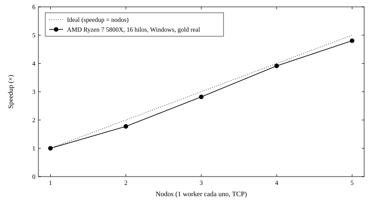

# 11. Rendimiento y escalabilidad del clúster

## 11.1 Protocolo de medición

<!-- pendiente: bloque 3 del informe (#71) -->

## 11.2 Resultados de 1 a 5 nodos

Con <!--v:(index .Cluster.Mediciones .Ultimo).Nodos-->5<!--/v--> nodos el entrenamiento es <!--v:dos (index .Cluster.Mediciones .Ultimo).Speedup-->4,80<!--/v--> veces más rápido que con uno (@fig:speedup-cluster).

<!-- pendiente: bloque 3 del informe (#71) — tabla de resultados y su análisis -->

{#fig:speedup-cluster}

Nota: La línea punteada es el speedup ideal (igual al número de nodos). Fuente: `reports/bench_cluster_*.json`.

## 11.3 Speedup, eficiencia y desglose del tiempo

<!-- pendiente: bloque 3 del informe (#71) -->

## 11.4 Punto de equilibrio del clúster

<!-- pendiente: bloque 3 del informe (#71) -->

## 11.5 Evidencias de la medición

<!-- pendiente: bloque 3 del informe (#71) -->
