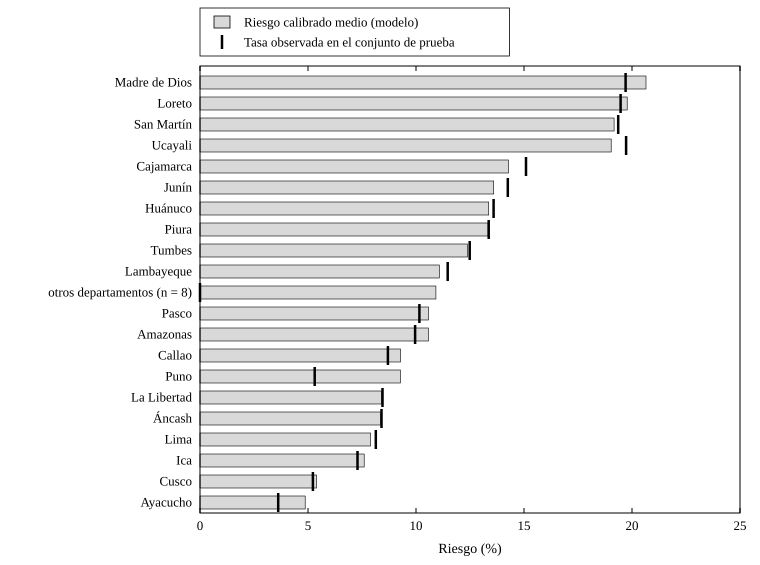
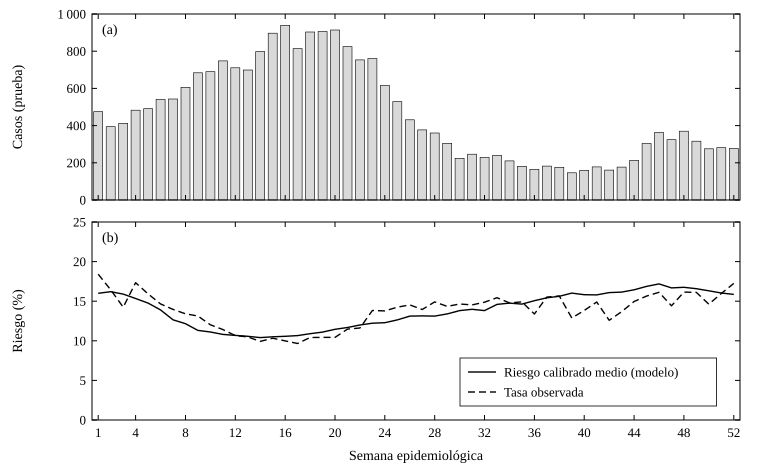

# 18. Respuesta a la pregunta de impacto social

La pregunta del proyecto (sección 2.2) es: **¿en qué departamentos, semanas epidemiológicas y grupos de edad conviene reforzar camas, vigilancia y cerco epidemiológico por dengue con signos de alarma?** Esta sección la responde con el modelo evaluado en la sección 17.

**Cómo se mide la necesidad.** La cifra central son los **casos esperados con signos de alarma o graves** de un grupo: la suma del riesgo calibrado de sus casos notificados. Combina dos cosas que importan a quien planifica: cuántos casos llegan (volumen) y qué tan probable es que cada uno se complique (riesgo). Un departamento con muchos casos de riesgo moderado puede necesitar más camas que uno con pocos casos de riesgo alto. Como el modelo está bien calibrado (@tab:calibracion), esa suma estima bien cuántos casos con signos de alarma tendrá el grupo. Las cifras son del conjunto de prueba, una muestra del <!--v:pct .S.M.S.FracTest-->20,00<!--/v--> % de los casos de 2011 a 2025, así que las proporciones valen para todos los casos del periodo.

## 18.1 Dónde reforzar

<!-- generado:plantilla:impacto-deptos -->
Tabla: Departamentos con más casos esperados con signos de alarma {#tab:impacto-deptos}

| # | Departamento | Casos de prueba | Riesgo calibrado medio (%) | Casos esperados con signos de alarma | Del total del país (%) | Acumulado (%) |
|---:|---|---:|---:|---:|---:|---:|
| 1 | Piura | 41 319 | 13,34 | 5 510 | 23,04 | 23,04 |
| 2 | Loreto | 17 548 | 19,78 | 3 470 | 14,51 | 37,55 |
| 3 | San Martín | 10 646 | 19,17 | 2 041 | 8,53 | 46,08 |
| 4 | Lima | 24 912 | 7,90 | 1 968 | 8,23 | 54,31 |
| 5 | Ucayali | 9 085 | 19,03 | 1 729 | 7,23 | 61,54 |
| 6 | La Libertad | 18 131 | 8,40 | 1 523 | 6,37 | 67,91 |
| 7 | Madre de Dios | 5 913 | 20,65 | 1 221 | 5,10 | 73,01 |
| 8 | Lambayeque | 10 317 | 11,08 | 1 143 | 4,78 | 77,79 |
| 9 | Ica | 13 670 | 7,60 | 1 039 | 4,34 | 82,13 |
| 10 | Tumbes | 8 064 | 12,38 | 999 | 4,18 | 86,31 |

Nota: Todas las semanas y edades. Casos esperados = suma del riesgo calibrado de los casos de prueba del departamento. Riesgo medio del país: 12,53 %. Fuente: `reports/evaluacion.json` (`riesgo.celdas`), ordenado por `cmd/informe`.
<!-- /generado -->

{#fig:riesgo-departamento}

Nota: Fuente: `reports/entrenamiento.json`, generado por `cmd/entrenar`.

**La necesidad está concentrada.** <!--v:.DeptosHasta 0.5-->4<!--/v--> de los <!--v:len .ImpactoDeptos-->21<!--/v--> departamentos o grupos del modelo (los de pocos casos se agrupan en «otros», sección 8.1) reúnen más de la mitad de los casos esperados con signos de alarma del país (@tab:impacto-deptos). El primero, <!--v:depto (index .ImpactoDeptos 0).Departamento-->Piura<!--/v-->, combina el mayor número de casos con un riesgo por caso de <!--v:dos (index .ImpactoDeptos 0).Razon-->1,06<!--/v--> veces el promedio del país. Los demás llegan arriba por dos caminos distintos, y eso cambia qué conviene reforzar:

- **Por volumen.** Departamentos con muchos casos y riesgo por caso cercano o inferior al promedio del país (<!--v:pct .Nacional.Riesgo-->12,53<!--/v--> %), como <!--v:.DeptosPorVolumen-->Lima, La Libertad, Lambayeque, Ica y Tumbes<!--/v--> en estos datos (razón frente al país igual o menor que 1). Lo que más se necesita ahí es **capacidad**: camas de observación y hospitalización, y personal para el triaje en los picos.
- **Por riesgo.** Departamentos con riesgo por caso al menos un 25 % mayor que el promedio del país: <!--v:.DeptosPorRiesgo-->Loreto, San Martín, Ucayali y Madre de Dios<!--/v-->, todos de la Amazonía. Ahí cada caso notificado tiene más probabilidad de complicarse, así que conviene reforzar la **vigilancia y el manejo clínico temprano**: identificar los signos de alarma a tiempo y derivar sin demora, sobre todo donde las distancias a un hospital son largas.

## 18.2 Cuándo reforzar

<!-- generado:plantilla:impacto-semanas -->
Tabla: Semanas epidemiológicas con más casos esperados con signos de alarma en el país {#tab:impacto-semanas}

| # | Semana | Casos de prueba | Riesgo calibrado medio (%) | Casos esperados con signos de alarma | Del total del año (%) |
|---:|---:|---:|---:|---:|---:|
| 1 | 20 | 8 764 | 11,45 | 1 004 | 4,20 |
| 2 | 16 | 9 405 | 10,56 | 994 | 4,15 |
| 3 | 19 | 8 690 | 11,10 | 965 | 4,03 |
| 4 | 18 | 8 670 | 10,90 | 945 | 3,95 |
| 5 | 15 | 8 689 | 10,51 | 913 | 3,82 |
| 6 | 17 | 8 422 | 10,66 | 898 | 3,75 |
| 7 | 21 | 7 191 | 11,68 | 840 | 3,51 |
| 8 | 14 | 8 040 | 10,40 | 836 | 3,50 |

Nota: Todo el país y todas las edades. La mitad de los casos esperados del año se concentra en 15 semanas consecutivas, de la 8 a la 22 (50,47 %). Fuente: `reports/evaluacion.json` (`riesgo.celdas`).
<!-- /generado -->

{#fig:riesgo-semana}

Nota: Fuente: `reports/entrenamiento.json`.

**La temporada alta es predecible.** La mitad de los casos esperados con signos de alarma del año cae entre las semanas <!--v:.TemporadaAlta.Desde-->8<!--/v--> y <!--v:.TemporadaAlta.Hasta-->22<!--/v-->, y la semana con más casos esperados es la <!--v:.TemporadaAlta.Pico.Semana-->20<!--/v--> (@tab:impacto-semanas). Como la semana epidemiológica es una variable del modelo (con su forma cíclica, sección 8.1), el riesgo de cada semana se puede consultar antes de que empiece la temporada. Esto permite **adelantar** los refuerzos: preparar camas y personal y activar el cerco epidemiológico (control del vector y búsqueda de casos alrededor de cada caso notificado) en las semanas previas al inicio de la temporada alta, y no cuando los servicios ya están saturados.

## 18.3 A quién priorizar

<!-- generado:plantilla:impacto-etapas -->
Tabla: Riesgo y casos esperados por etapa de vida en el país {#tab:impacto-etapas}

| Etapa de vida | Casos de prueba | Tasa observada (%) | Riesgo calibrado medio (%) | Razón frente al país | Casos esperados con signos de alarma | Del total del país (%) |
|---|---:|---:|---:|---:|---:|---:|
| niño (0–11 años) | 32 078 | 14,66 | 14,79 | 1,18 | 4 745 | 19,84 |
| adolescente (12–17 años) | 25 914 | 13,61 | 13,55 | 1,08 | 3 512 | 14,68 |
| joven (18–29 años) | 43 650 | 12,82 | 12,67 | 1,01 | 5 531 | 23,13 |
| adulto (30–59 años) | 71 864 | 11,11 | 11,08 | 0,88 | 7 963 | 33,29 |
| adulto mayor (60 años a más) | 17 313 | 12,66 | 12,52 | 1,00 | 2 167 | 9,06 |

Nota: Todas las semanas y departamentos. «Razón frente al país»: riesgo de la etapa dividido entre el riesgo medio del país; mayor que 1, más riesgo que el promedio. Fuente: `reports/evaluacion.json` (`riesgo.celdas`).
<!-- /generado -->

Dos grupos destacan por motivos distintos (@tab:impacto-etapas):

- **Niños (0–11 años).** Tienen el mayor riesgo por caso: <!--v:dos (index .EtapasPais 0).Razon-->1,18<!--/v--> veces el promedio del país. Conviene asegurar **capacidad pediátrica** (camas y personal capacitado en el manejo de signos de alarma en niños) en los departamentos y semanas de la temporada alta.
- **Adultos (30–59 años).** Su riesgo por caso es menor que el promedio, pero por su número son el grupo con más casos esperados. Es el grupo que más camas ocupa en total, y donde más rinde la búsqueda activa de casos durante el cerco epidemiológico.

La @tab:prioridades combina las tres dimensiones: las combinaciones de departamento, semana y etapa de vida con más casos esperados. Es la lista que la vista de inicio de la SPA muestra al analista (@fig:inicio), y que el mapa permite explorar para cualquier otra combinación.

<!-- generado:plantilla:prioridades -->
Tabla: Combinaciones de departamento, semana y etapa de vida con más casos esperados con signos de alarma {#tab:prioridades}

| # | Departamento | Semana | Etapa de vida | Casos de prueba | Riesgo calibrado (%) | Casos esperados | Del total del país (%) | Acumulado (%) |
|---:|---|---:|---|---:|---:|---:|---:|---:|
| 1 | Piura | 20 | adulto (30–59 años) | 1 307 | 12,38 | 162 | 0,68 | 0,68 |
| 2 | Piura | 19 | adulto (30–59 años) | 1 139 | 12,35 | 141 | 0,59 | 1,27 |
| 3 | Piura | 22 | adulto (30–59 años) | 1 024 | 12,61 | 129 | 0,54 | 1,80 |
| 4 | Piura | 18 | adulto (30–59 años) | 1 054 | 12,24 | 129 | 0,54 | 2,34 |
| 5 | Piura | 21 | adulto (30–59 años) | 996 | 12,48 | 124 | 0,52 | 2,86 |
| 6 | Piura | 16 | adulto (30–59 años) | 910 | 11,99 | 109 | 0,46 | 3,32 |
| 7 | Piura | 17 | adulto (30–59 años) | 844 | 12,13 | 102 | 0,43 | 3,75 |
| 8 | Piura | 23 | adulto (30–59 años) | 774 | 12,72 | 98 | 0,41 | 4,16 |
| 9 | Piura | 15 | adulto (30–59 años) | 823 | 11,88 | 98 | 0,41 | 4,57 |
| 10 | Piura | 20 | joven (18–29 años) | 688 | 13,60 | 94 | 0,39 | 4,96 |

Nota: Solo combinaciones con al menos 30 casos de prueba. Es la misma lista que muestra la vista de inicio de la SPA. Fuente: `reports/evaluacion.json` (`prioridades`).
<!-- /generado -->

La concentración de la lista en un solo departamento refleja el volumen de casos notificados allí en el periodo: los años de grandes brotes pesan más en los datos agregados de 2011 a 2025. Por eso la SPA permite filtrar por semana y etapa, y el mapa muestra también el riesgo por caso, que no depende del volumen.

## 18.4 A cuántas personas beneficia

Un plan que concentre los refuerzos en los <!--v:len (.Cobertura 4).Deptos-->4<!--/v--> departamentos con más casos esperados durante la temporada alta (semanas <!--v:(.Cobertura 4).Desde-->8<!--/v--> a <!--v:(.Cobertura 4).Hasta-->22<!--/v-->) cubriría el <!--v:pct (.Cobertura 4).Fraccion-->29,44<!--/v--> % de los casos con signos de alarma o graves que se esperan en todo el país en el año, concentrando los recursos en solo el <!--v:pct (.Cobertura 4).Celdas-->5,49<!--/v--> % de las combinaciones de departamento y semana. Llevado de la muestra de prueba al total de casos y a un año promedio del periodo (<!--v:(.Cobertura 4).Anos-->15<!--/v--> años), son unas <!--v:miles (entero (.Cobertura 4).EsperadosAnual)-->2 347<!--/v--> personas por año con signos de alarma o graves atendidas dentro del ámbito del plan.

Esa cifra es un promedio: el dengue en el Perú tiene años epidémicos con varias veces más casos que otros (@fig:casos-ano), y en esos años el número de personas beneficiadas crece en la misma proporción, mientras el plan sigue dirigiendo los recursos a los mismos lugares y semanas. El beneficio no es solo el número de personas: reforzar donde y cuando se concentra la necesidad reduce el tiempo de espera para la hospitalización de los casos con signos de alarma, que es lo que evita que progresen a dengue grave (World Health Organization, 2009).

## 18.5 Recomendación operativa

Tabla: Recomendación por tipo de refuerzo {#tab:recomendacion}

| Refuerzo | Dónde | Cuándo | A quién | Con qué evidencia |
|---|---|---|---|---|
| **Camas** de observación y hospitalización | Departamentos con más casos esperados (@tab:impacto-deptos), empezando por los que llegan ahí por volumen | Desde unas semanas antes del inicio de la temporada alta hasta su fin (@tab:impacto-semanas) | Adultos por volumen y capacidad pediátrica para los niños | Casos esperados por departamento, semana y etapa |
| **Vigilancia** y manejo clínico temprano | Departamentos con riesgo por caso superior al promedio del país | Toda la temporada alta | Niños, el grupo de mayor riesgo por caso | Riesgo calibrado por departamento y etapa |
| **Cerco epidemiológico** | Los departamentos y semanas de la @tab:prioridades | Al inicio de la temporada alta, antes del pico | Toda la población del área | Combinaciones con más casos esperados |

Nota: Elaboración propia a partir de las tablas de esta sección. El sistema actualiza las cifras cada vez que se reentrena el modelo con datos nuevos.

**Cómo se usaría.** Antes de cada temporada, el analista de la DIRESA abre Vigía, revisa la vista de inicio y el mapa de su región por semana y por etapa de vida, y consulta el riesgo de los casos que llegan. Con un año nuevo de datos, el administrador reentrena el modelo desde el panel en pocos segundos en el clúster, y todas las vistas se actualizan con el modelo nuevo.

## 18.6 Limitaciones

- **Poder predictivo moderado.** Con un AUC de <!--v:cuatro .Eval.Metricas.AUC-->0,6221<!--/v-->, el modelo sirve para planificar con grupos de casos, no para decidir sobre un paciente: la decisión clínica sigue siendo del médico, con los criterios de la guía de la OMS.
- **Solo variables demográficas, de lugar y de tiempo.** El conjunto de datos abiertos no incluye comorbilidades, serotipo, infección previa ni resultados de laboratorio, que explican buena parte de la gravedad. Con esas variables el modelo mejoraría, pero no son públicas.
- **Casos notificados.** El modelo aprende de los casos que el sistema de vigilancia registró: donde hay menos acceso a los servicios de salud, se notifica menos, y la necesidad real puede ser mayor que la estimada.
- **Clasificación por año.** La proporción de casos con signos de alarma cambia entre años por razones que los datos no explican (sección 6.3). El modelo incluye el año como tendencia, pero un cambio en los criterios de notificación afectaría sus estimaciones.
- **Datos agregados del periodo.** Las prioridades reflejan el promedio de 2011 a 2025, en el que pesan más los años de grandes brotes. Para un año concreto, conviene filtrar por las semanas y regiones de interés en la SPA y reentrenar con los datos más recientes.
